# CS302 Operating System Final Review

Name: Changxin (Daniel) Chen

## Lecture 8 Synchronization

1. 竞争条件（Race Condition）是一种程序错误，当多个线程或者进程同时访问或者修改同一个共享资源的时候，并且访问顺序影响结果时候，就可能发生

2. 可能的发生条件：shared object, multiple processes/threads, concurrently

3. 解决方案: Mutual Exclusion, that is when one process access the shared memory, no one else could access it

4. **Critical section** is the code segment that is accessing the shared object. 即当一个process enter了critical section时候，另一个process是不能enter的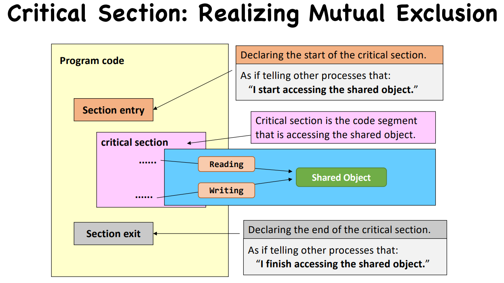

5. Critical Section Implementation(Requirements: Mutual Exclusion, Bounded Waiting就是当一个process在访问时候就会有一个对于别的process来说等待的时间, Progress就是如果当前没有人在critical section那么就会有一个process最终使用)

   1. Disabling Interrupts

      当一个进程进入临界区时，**临时关闭中断（disable interrupts）**，这样处理器不会被其他任务打断，就可以避免其他进程在同一时间访问共享资源。

      1. 单核CPU kernel mode可使用，user mode不可使用(如果进入infinite loop)
      2. 多核CPU无法使用，因为可能other core访问这个shared object

   2. Locks(atomic instruction)

      1. Spin-based locks 自旋锁，就是当一个线程试图进入临界区时候发现锁被占用，他不会进入休眠状态，而是不停的轮询查看锁变量

         这个correct而且short waiting但是waste CPU resources

         但是这个可能会出现一个violation就是: Sometimes you give me my turn but I’m not ready to enter critical section yet.

         解决方案就是Peterson's Solution: 就是interested[me] = true, turn = other使用判断语句turn == other && interested[other] == TRUE 表示需要等待 总结起来就是"让步兴趣"

         然而扩展到Multi-Process Mutual Exclusion需要添加`test_and_set()`原子操作 

         `test_and_set()` 是一种 **原子操作**，它可以：

         - **以不可中断的方式读取一个值并设置它**
         - 避免多个进程同时判断自己可以进入临界区 ⇒ 确保互斥

         A process can enter the critical section if either waiting [i] == FALSE or key == FALSE

         这个算法的核心思想是使用：

         - 一个共享的原子操作：`test_and_set()` —— 一种原子地“测试并设置”变量的操作。
         - 一个共享的布尔变量 `lock`
         - 一个每个进程对应的布尔数组 `waiting[n]` 来表示它是否在等待进入临界区
         - 所有进程循环竞争进入临界区，遵守互斥和公平原则。

   Priority Inversion

   这是一个问题：低优先级进程反过来阻塞了高优先级进程的运行，相当于高优先级的进程一直抢占了CPU却无法前进（因为低优先级进程无法获得CPU而完成他的工作然后释放锁）

2. Sleep-based lock: Semaphore
   
   信号量包括: counter表示可用资源的数量，以及一个waiting-list 
   
   **初始值为 1**，就是所谓的 **Binary Semaphore（二进制信号量）**，可实现互斥（即**同时只有一个进程进入临界区**）。
   
   必须涉及内核，当enter(sem_wait())时候counter-1，直到counter=0进入sleep; 当exit(sem_post)时候counter+1,如果有进程等待就唤醒一个
   
   操作计数器以及等待队列必须是**原子的**
   
   Implementation: Must guarantee that no two processes can execute sem_wait() and sem_post() on the same semaphore at the same time 必须是原子的
   
   Using Semaphore beyond Mutual Exclusion:
   
   1. Producer-Consumer Problem (☆) : use binary semaphore to avoid race condition and two counting semaphores(fill and avail) to achieve synchronization.
      
      如果wait顺序不对会造成deadlock死锁问题：Consumer waits for Producer’s mutex at line 6 AND Producer waits for Consumer’s avail at line 7
      
   2. Dining Philosopher Problem
      
      容易造成deadlock: 所有的哲学家thinking at the same time然后都拿起左边的筷子，这样就会让所有的哲学家都开始waiting 
      
      如果是对chopstick那么会造成两个问题：如果semaphore chopstick -> deadlock；但是如果使用sleep()来avoid的话就可能无法推进progress
      
       Final Solution: 每个哲学家有三个状态: HUNGRY, THINKING, EATING，过程大概是这样的：一个人开始吃之前(HUNGRY)会询问左右边在不在吃，如果都不在就直接开始吃；只要有一个人开始吃了，那captain就会告诉他不能开始吃，就开始等待wait(&p[i])，当有人吃完了就会通过captain通知左右的人，然后captain就唤醒post(&p[i])，那个人就可以开始吃了。
      
       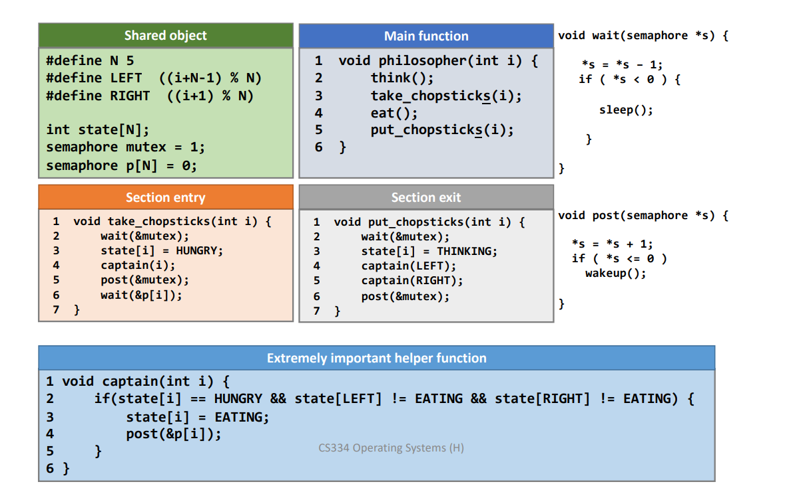
      
         3. Reader Writer Problem？好像没讲

## Lecture 9 CPU Scheduling

1. Two types of processes: CPU-bound process(user-time > sys-time), I/O-bound process(sys-time > user-time)

2. CPU burst: Process execution consists of a cycle of CPU execution and I/O wait.

3. CPU Scheduler: 来选择一个process来执行

   发生选择的情况可能有以下几种情况：

   1. running -> waiting (non-preemptive)
   2. running -> ready (preemptive)
   3. waiting -> ready (preemptive)
   4. Terminates (non-preemptive)

   scheduling 算法设计criteria: minimize average turnaround time(任务从到达系统开始，到它完全结束所经历的总时间), minimize average waiting time, reduce the number of context switches.

### Scheduling Algorithms

1. Shortest-job-first(SJF)

   有preemptive, non-preemptive两种情况

   The waiting time and the turnaround time decrease at the expense of the increased number of context switches.

2. Round-robin (RR)

   preemptive抢占式算法 

   quantum用完的process和一个新的process同时进入队列时候旧的应该放前面

   The **responsiveness** of the processes is great under the RR algorithm.

3. Priority scheduling

   有preemptive, non-preemptive两种情况，以及也有Static priority and dynamic priority两种情况

Linux Scheduling 目前使用的是 CFS – Completely Fair Scheduler

1. CFS assigns a proposition of CPU processing time to each task

2. Nice value: nice value越低priority越高, lower nice value就会有higher proportion of CPU time

3. Virtual run time: vruntime 表示这个进程“公平地”运行了多长时间，和真实运行时间不同，它会根据优先级（nice值）进行调整

   Lower priority has higher rate of decay 相当于nice越高优先级越低越先用完“公平时间(vruntime)”

   nice<0 vruntime 将会increase by less than its real time.
   
   当需要选择下一个task时候系统会选择smallest vruntime value的那个任务
   
   vruntime of I/O bound will be shorter than vruntime of CPU bound，因为CFS是根据运行在CPU上的时间来增加vruntime的，所以vruntime of I/O bound显然更短。

## Lecture 10 Deadlock

1. Deadlock(circular waiting for resources) vs Starvation(线程永无止境的等待)
   1. Deadlock可以带来Starvation, Starvation无法带来Deadlock
   2. Starvation可以end，但是在external intervention之前deadlock不会中止
2. Deadlock的4个requirements
   1. **Mutual exclusion**: Only one thread at a time can use a resource.（互斥：线程对于需要的资源进行互斥的访问（例如一个线程抢到锁））
   2. **Hold and wait**: Thread holding at least one resource is waiting to acquire additional resources held by other threads
   3. **No preemption**: Resources are released only voluntarily by the thread holding the resource, after thread is finished with it
   4. **Circular wait**
3. Resource-Allocation Graph: V is partitioned into two types, which are T(threads), R(resources)
   1. request edge – directed edge Ti -> Rj
   2. assignment edge – directed edge Rj -> Ti
4. Deadlocks Handling
   1. Deadlock detection: Allow system to enter deadlock and then recover
      1. Looking for cycles
      2. Detection Algorithm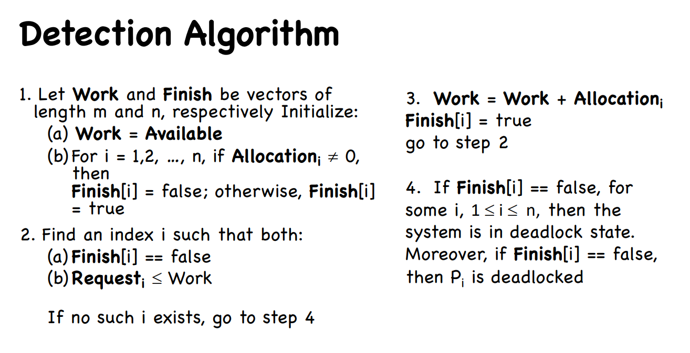
      3. If detected:
         1. Terminate process, force it to give up resources
         2. Preempt resources without killing off process 
         3. Roll back actions of deadlocked process
   2. Deadlock prevention: Ensure that system will never enter a deadlock 核心idea是让4个quirements无法同时满足
      1. Remove “Mutual Exclusion” not possible for non-sharable resources
      2. Remove “Hold and Wait” must guarantee that whenever a process requests a resource, it does not hold any other resources
      3. Remove “No preemption” If a process that is holding some resources requests another resource that cannot be immediately allocated to it, then all resources currently being held are released 如果进程请求新资源失败，系统会**回收它当前持有的资源**，让它**等全部资源都可用时再运行**，这样就防止了死锁
      4. Remove "Circular Wait" 通过给资源编号并强制进程按编号递增的顺序申请资源这样就避免了circular 应该是经常采用最实用的预防技术
   3. Deadlock Avoidance: **和“死锁预防”不同，死锁避免不是一致地限制系统行为，而是动态判断“这一资源分配会不会导致死锁”，只有在**确定安全时**才允许分配资源**
      1. 每个进程在开始前必须申报它可能需要的“每种资源”的最大数量，死锁避免算法会**动态检查当前资源分配的状态**，确保系统不会进入“循环等待”的危险状态 在被分配resource之前系统必须确保分配之后是safe state
      2. 一个系统是safe state“安全的”，只要：（安全状态意味着未来一定不会有死锁）
         - 存在某个进程顺序，使得所有进程都可以**按这个顺序执行完并释放资源**；
         - 哪怕某些资源现在还不够用，只要**将来一定够用**（通过等待前面进程释放），就没问题。
         
         Tip: 检查是否安全不能用request resource来计算，需要使用max来计算
      3. Banker's Algorithm: 先通知系统自己的max allocation是多少(估计)，然后如果请求的资源小于available并且分配之后还是safe state那么就分配给他
   4. Ignore the problem and pretend that deadlocks never occur in the system(Used by most OS)

## Lecture 11 I/O

1. IO有三个challenges: Diverse device, Unreliable device, Unpredictable and slow devices

2. A Canonical View of Devices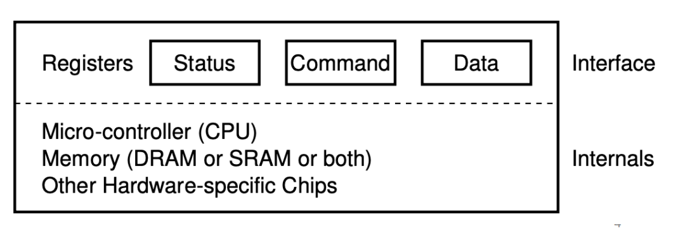

3. I/O

   1. Polling(Basic) 工作流程是OS不断检查status register直到设备准备好然后将数据写入 然后不断等待check等待这个设备是否finish 

      问题就是CPU浪费大量时间，利用率低

   2. Interrupts(Efficient, **asynchronously**)

      进程发出I/O请求，CPU并不用理会可以挂起然后switch去执行别的任务，当这个device完成操作了，他会发起一个hardware interrupt 然后CPU就会跳到interrupt handler去处理中断

   3. 选择哪个？

      1. Fast device -> polling, Slow device -> interrupt
      2. Hybrid if unknow or unstable

   4. Hardware Support for Interrupts

      Interrupt-request line 中断请求线: a CPU wire triggered by I/O device, Save CPU state and jumps to the interrupt handler

      Interrupt-controller hardware 中断控制器: 帮助管理所有中断信号可以处理延迟，分发对应处理函数，多级终端支持不同优先级的中断

   5. Software Support for Interrupts

      Interrupt handler 接收中断

      A table of interrupt vectors to specify interrupt-handling routine 一个中断处理的向量表，不同的中断分发给不同的handler

      Interrupt chaining（中断链接）是指有时多个设备共享一个中断编号，系统依次调用直到找到响应的那个设备

4. Programmed I/O

   1. Two approaches to control devices
      1. Explicit I/O instructions：专用指令对IO进行操作
      2. Memory-mapped I/O：registers/memory出现在物理地址空间，通过load, store等这些指令操作，优点是可以使用普通内存操作方式读写I/O设备，更统一也更高效

   2. **More Efficient Data Movement: DMA**

      motivation实际上是为了减少CPU在向设备传输数据的时间，为了分离这项工作提供CPU利用率

      所以引入DMA这个来解决PIO处理large data movement的策略: CPU先设置DMA控制器（指定源地址、目标地址、字节数等），然后DMA控制器直接控制内存和设备间的数据传输，DMA控制器临时掌控总线访问权，进行**cycle stealing**（抢CPU的时钟周期）来完成传输，完成之后interrupt.

   3. Device Driver

      设备驱动是内核中一部分代码，用于直接与硬件交互。

      提供标准接口，让操作系统通过统一方式与各种设备交互 隐藏设备差异，实现设备无关性
   
   1. Top Half：响应系统调用（如 `read()`、`write()`），初始化I/O操作并可能将进程挂起
      
   2. Bottom Half：处理中断（例如数据准备好了），唤醒等待的进程
   

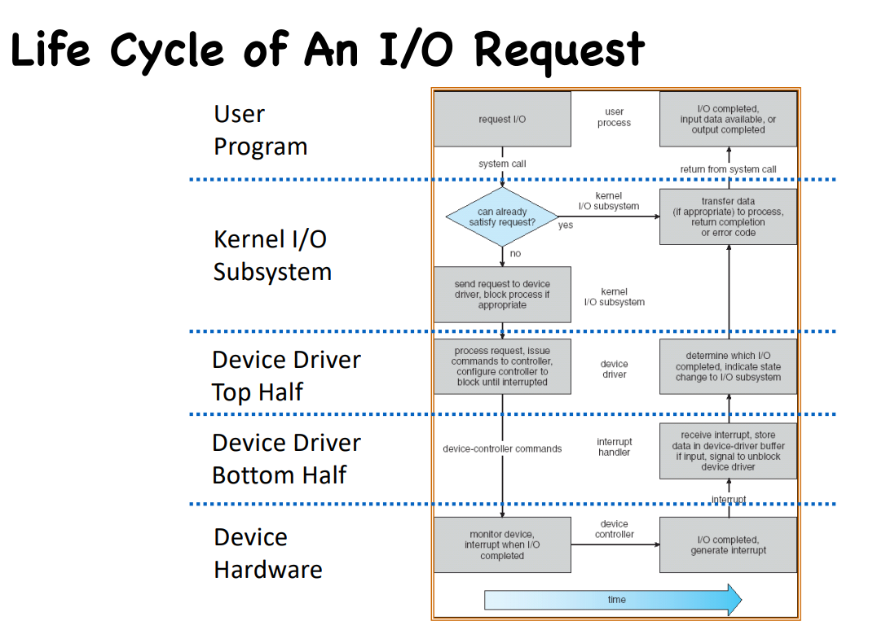

5. Application I/O Interface
   
   应用程序通过系统调用（如 `read()`、`write()`、`open()`）与设备交互。
   
   设备驱动隐藏了不同控制器的差异，内核只需统一接口
   
6. I/O Devices Characteristics: 
   
      Broadly I/O devices can be grouped by the OS into
   
      1. Block I/O：块设备(includes disk drives), Commands include read, write, seek 支持 `read`/`write`/`seek`，支持DMA、内存映射文件
      2. Character I/O (Stream) : 字符设备 逐字符读写，如 `get()` `put()`
   3. Memory-mapped file access
   
   4. Network sockets
      
   7. Nonblocking and Asynchronous I/O
   
      1. Blocking (阻塞I/O) 系统调用执行期间，进程会挂起直到I/O完成
      2. Nonblocking (非阻塞I/O) 系统调用立刻返回，返回已完成的部分
      3. Asynchronous (异步I/O) I/O在后台执行，完成后通过信号/中断/回调通知进程，不影响程序运行

## Lecture 12 Storage

Storage Devices: Magnetic disks, Flash memory （磁盘的存储一般是2^次幂，而速率一般是1000这种）

1. Magnetic disks(磁盘，如传统的硬盘HDD)：Storage that rarely becomes corrupted，成本较低，Block level random access，随机访问性能较差但顺序访问性能较好

   基本构造: 最小传输单位sector, 多个扇圈围成的track, 多个磁道track上下同一位置组成的立体图形是cylinder（cylinder是说磁盘上同一位置多个盘面上的同心圆的集合）, 读写头head可以在柱面上移动让磁盘旋转使得目标扇区到读写区下面

   所以data 读写主要是three-stage:

   1. seek time: 移动磁头到正确的磁道（相当于是移动到目标柱面）
   2. rotational latency: 等待目标扇区旋转到读写区下面
   3. transfer time: 将实际数据读入或写入磁盘

   Read sector from random place on disk: seek + rotate + transfer

   Read sector from random place in the same cylinder: rotate + transfer

   Read next sector on same track: transfer （当然以上这些计算基础都是ignoring queuing and controller times）

   Key to using disk effectively (especially for file systems) is to minimize seek and rotational delays

2. Flash memory(闪存，如SSD)：Storage that rarely becomes corrupted，成本更高，Block level random access，读取速度非常快但随机写入时性能较差

   No moving parts (no rotate/seek motors): • Eliminates seek and rotational delay (0.1-0.2ms access time) • Very low power and lightweight • Limited “write cycles”

Disk scheduling 应用广泛，OS应该考虑如何高效使用硬件 minimize seek time, movement distance...

1. FIFO: Fair among requesters, but order of arrival may be to random spots on the disk -> Very long seeks
2. SSTF(Shortest Seek Time First): Shortest Seek Time First selects the request with the minimum seek time from the current head position
3. SCAN: 从起始点向一边移动依次访问，移到到之后向另一边移动就能扫描到所有点 但是如果某一头过于density可能造成等待时间太长的问题 注意到最后不用移动到另一端端点，只用扫描完所有的点
4. CSCAN: 优化了这个问题使得等待时间更加uniform 先向一端移动处理所有点然后到达磁盘末端后，**快速跳转回磁盘最边上的端点**，然后继续扫描，以此实现 **更公平、均匀的等待时间分布**，适合实时性要求更高的系统。
5. LOOK, C-LOOK 就是上面两种方法的变体，但是不会到达磁盘端点，而是到达需要处理的最远点就返回，到中介点也是一样的，只会扫描到最远点

选择一种scheduling算法：

1. SSTF is common and has a natural appeal
2. SCAN and C-SCAN perform better for systems that place a heavy load on the disk: Less starvation
3. Either SSTF or LOOK is a reasonable choice for the default algorithm
4. 这个算法应该separate from module of OS, allowing it to be replaced by a different algorithm.

## Lecture 13 File System

File system 就是 Layer of OS that transforms block interface of disks into Files, Directories

有四个components: Naming, Disk Management, Protection, Reliability/Durability

1. user view VS system view

   用户视角认为文件是一种持久的数据结构，系统视角并不关心你存的是什么内容只看得到字节序列

   视角的转换: 用户请求读写，系统找到block然后进行对应的修改

   用户看到的是字节，系统看到的是块；用户操作的是逻辑数据，操作系统处理的是整个数据块。

   file is a collection of blocks

2. Directory: basically a hierarchical structure

3. File: named permanent storage, 包括data(blocks on disk)以及metadata(owner, size, access right...)

4. Disk Management Policies 

   1. basic entities on disk: file, directory

   2. Access disk as linear array of sectors

      1. 使用三元组方法，现在已废弃
      2. LBA(logical block addressing): every sector has integer address form zero up to max number of sectors

   3. 如何追踪空闲的磁盘

      1. linked free blocks -> too slow
      2. using bitmap to represent free space on disk(0,1)

   4. 如何structure files: file header 跟踪which blocks belong at which offsets within the logical file structure

      OS 会尽量把文件的 block 放在磁盘上 **连续或接近的位置**，以提高性能

### File system

1. Contiguous Allocation（出现external fragmentation）

2. Linked Allocation 

   思想是chop storage device and data into equal-sized blocks，但是每个block需要4 bytes作为指针指向下一个block 

   可能会出现internal fragmentation 以及access性能会下降因为要遍历前面的所有block

   FAT(file allocation table) 管理所有的block以及指针对应关系

   1. directory entry (32-byte directory entry in a directory file)

   2. 在FAT中block也被称为cluster

   3. FAT 32 只有28位有用 （最后4位存储file size） 所以最大的file size是2^32Bytes-1(4GB-1)

   4. LFN(long file name) 提出这个概念支持8+3的完整名字存储 每个LFN entry代表13 characters in Unicode

   5. directory存储start cluster number, file size, all file attributes

   6. reading file, appending file(往后面接着使用空的block同时更新指针指向)

   7. FSINFO记录free cluster的个数以及next free cluster

   8. 删除过程时候deallocate all blocks involved, update FSINFO and FATs

      然后只是改变directory entry的first byte 实际上没有彻底删除
      
      如何恢复？立刻拔掉电源，如果是在一个cluster就很好恢复（Because the first cluster address in the	directory entry is still readable, the recovery is having a very high successful rate.），如果超过一个cluster那么会很复杂

   总结来讲FAT是一个最通用的filesystem支持广泛 

   Simple to implement but poor performance and no security

3. iNode(index node) Allocation

   Unix File System(UFS) 中

   1. file number对应index of iNode arrays
   2. multi-level index structure 像一个不平衡树，直接指针指向小文件的实际数据块，间接指针支持更大的文件 所以是一个可扩展的目录结构

   一个directory/file has one iNode, 所有的pointer都在一起不像FAT中pointer是分布在每一个file

   iNode Table is an array of iNodes

   每个iNode包含以下信息: File Metadata, Direct Pointers(small files: 12 pointers direct to data blocks), Indirect Pointers(double, triple... 4 kB blocks => 1024 ptrs => 4 MB @ level 2 => 4 GB @ level 3 => 4 TB @ level 4)

   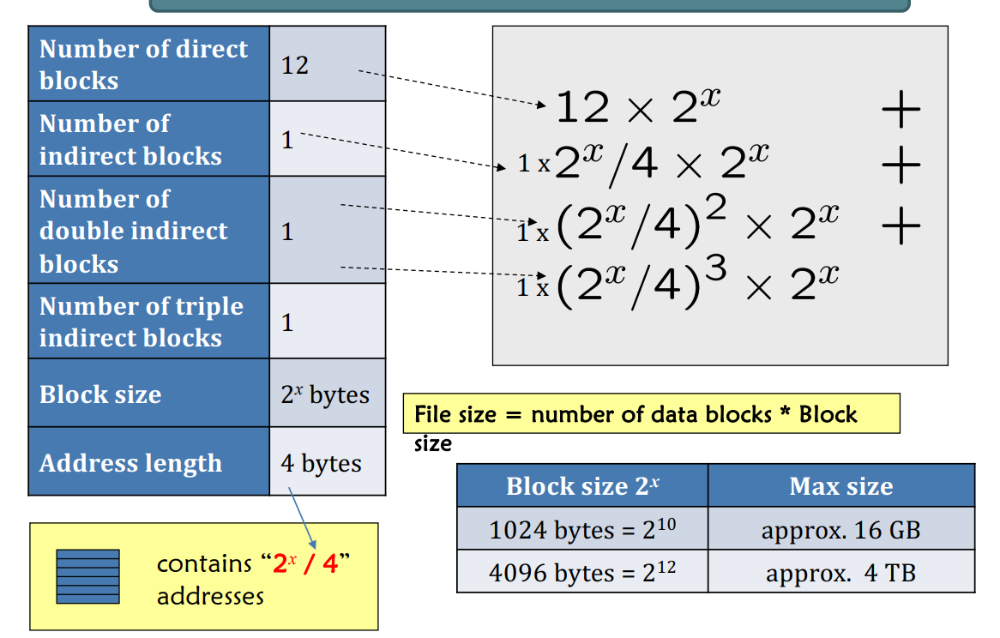

   Ext 2/3/4 它们是 Linux 系统中常用的**文件系统类型**，用来管理磁盘上的文件和目录。（Fourth Extended File system, Ext4）文件名保存在目录中，属性保存在inode中

   Ext 2/3 file system is divided into block groups and every block group has the same structure 

   having groups的原因是：performance(spatial locality，比如iNodes, data blocks的一些信息应该存储在一起) and reliability

   1. Disk Layout

      Ext 文件系统将一个block group分成几个部分：
      1. **Superblock**：存储文件系统的元信息（比如块大小、inode 数量等）。
      2. **Group Descriptor Table**：每个块组的描述信息。（block bitmap, inode bitmap等locations）
      3. Block Bitmap, Bitmap tells which data block is allocated.
      4. iNode Bitmap: A bit string represents if an iNode is allocated or not.
      5. **iNode Table**：存储文件的元数据（权限、大小、指针等）。
      6. **Data Blocks**：真正存储文件内容的地方。

   2. Directory

      File deletion is just an update of the entry length

   3. Hard and soft links

      1. A hard link is a directory entry pointing to the iNode of an existing file

         link count: this field in an inode indicates how many directory entries are pointing to it. 

         使用unlnk() system call when you delete a file, its job is to decrement the link count by one. 如果这个reaches 0, the data blocks and the inode will be deallocated

         **本质**：创建一个新的目录项（文件名），指向**相同的 inode**。

         **作用**：为同一个文件创建多个“名字”，它们共享文件的实际数据。

      2. Symbolic link(Soft link) is creating a new inode and point to the new iNode whose target's pathname are stored using the space originally designed for 12 direct blocks and the 3 indirect block pointers if the pathname is shorter than 60 characters.

         **本质**：创建一个**新文件**，该文件内容是**目标文件的路径名**。

         **作用**：像快捷方式一样，通过路径间接访问另一个文件。

      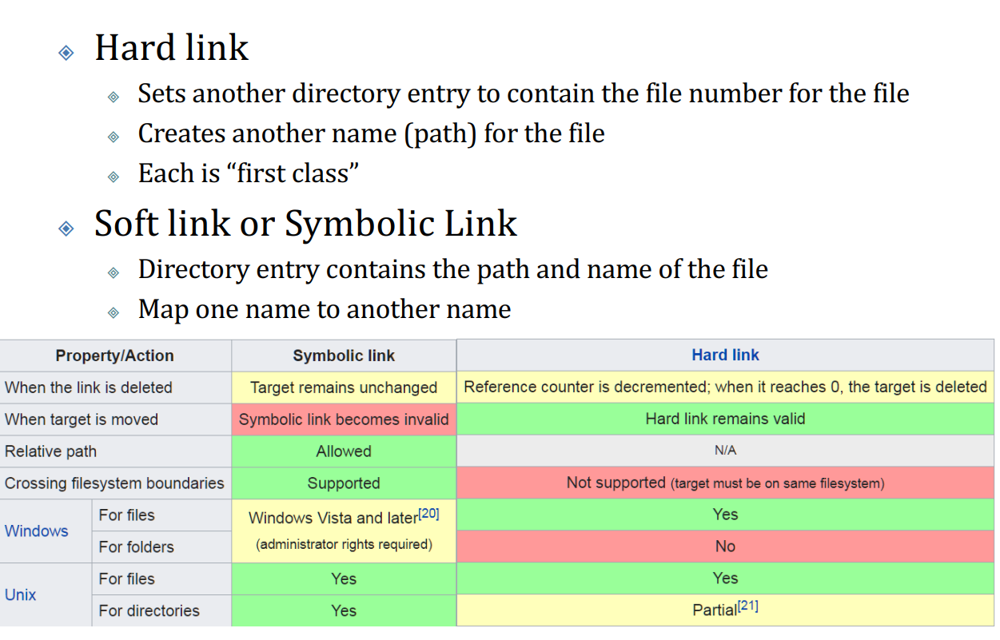

   4. Memory Mapped Files

      传统IO读写文件时，需要**显式地调用系统调用**（如 `read()` / `write()`）。

      而Memory-Mapped IO时候OS允许系那个文件直接映射到进程的地址空间中

      **读时**：访问该内存地址，操作系统自动**按页加载**文件内容（page in）。

      **写时**：写入内存，稍后再由操作系统**自动写回磁盘**（page out）。

      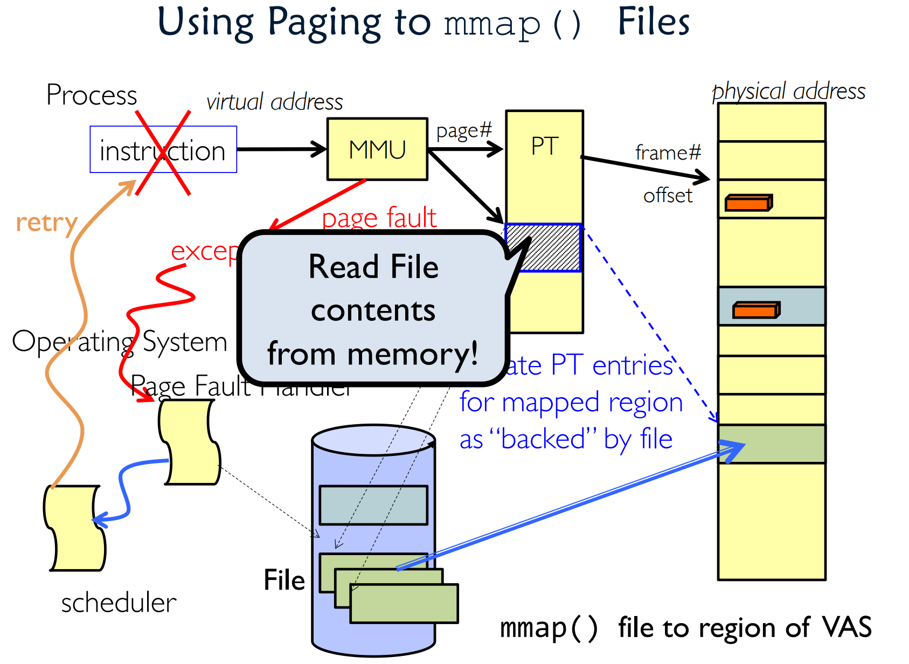

   5. Summary(☆？)

## Lecture 14 Security

### Confinement

 操作系统有时必须运行untrusted code时，系统必须confine it: 

1. Prevent it from accessing memory/files of other applications
2. Prevent it from doing things only kernel can do: Privileged instructions, I/O, privileged registers, etc. 
3. Prevent its faults from interfering with the rest system 

Confinement就是 restrict the interactions of a program to a limited set of resources AND prevent unintended interference with other parts of the system

Key approaches to achieve confinement are as following:

1. Isolation: boundary enforcement

   1. Physical Isolation: Run isolated programs on a physically separated computer

   2. Hardware Isolation

      1. Run isolated program in lower privilege levels, e.g., user mode

         比如说使用accessing privileged registers, page tables configured by OS kernel, U-bits in PTEs

      2. Run isolated program within a process(MPK, MTE)

         **进程内隔离（Intra-process compartmentalization）**：在**同一个进程**内部对代码或数据进行隔离，防止模块之间互相干扰。

         1. Intel Memory Protection Keys (MPK) 把内存分为多个区域，每个区域有一个**保护键（Key）**。

            每个线程维护自己的访问权限寄存器（PKRU register, Access disable(AD) and Write disable(WD) two bits）。无需切换页表即可实现隔离，适合**快速上下文切换**。

            RDPKRU/WRPKRU Instructions: Instructions to read from and write to the PKRU register

            这样做的优点就是更改页面访问权限很快，无需修改页表来触发上下文切换

   3. Software Isolation

      Run isolated program in a confined environment within (Kernel, User process)

      1. Software fault isolation(SFI，也是一种Intra-process compartmentalization进程内的区域化) enforces security boundaries between software components at runtime via compile-time or runtime instrumentation 这样isolate untrusted or error-prone modules

         具体来说就是memory sandboxing控制内存访问, control-flow的限制, Instruction-level Sandboxing指令级别的过滤过滤掉危险的指令

      2. Extended Berkeley Packet Filter (eBPF，是一种Intra-kernel compartmentalization) eBPF 是 Linux 内核中的一个**安全、高效的虚拟机环境**，可以运行用户定义的程序。运行时无需修改内核源代码或加载内核模块，**安全且灵活**。

         工作流程：Load(User space loads eBPF bytecode into kernel) -> verify -> attach(Program hooks to events) -> run(JIT-compiled execution when events trigger)

2. Access control: permission management

   Key components: subjects(user/process), objects(file/devices), permissions(read/write/execute)

   Implementation: Access control matrix, Access control list, Capacity(list of tokens held by subjects)

   1. Discretionary Access Control (DAC) **DAC** 是用户自主设置权限的方式，灵活但安全性较弱；

   2. Mandatory Access Control (MAC) **MAC** 是系统强制控制（统一管理）的机制，提供更高安全性；

   3. Capability 是一种不可伪造的令牌/密钥，授权主体（如用户或进程）访问特定对象（如文件、设备）。与 ACL 不同，**Capability 存储在“主体”手中**，而不是“对象”上。

      工作流程: Issuance, Access Request, Validation, Action

      Key properties: unforgeable, delegable, self-describing, no global checks

      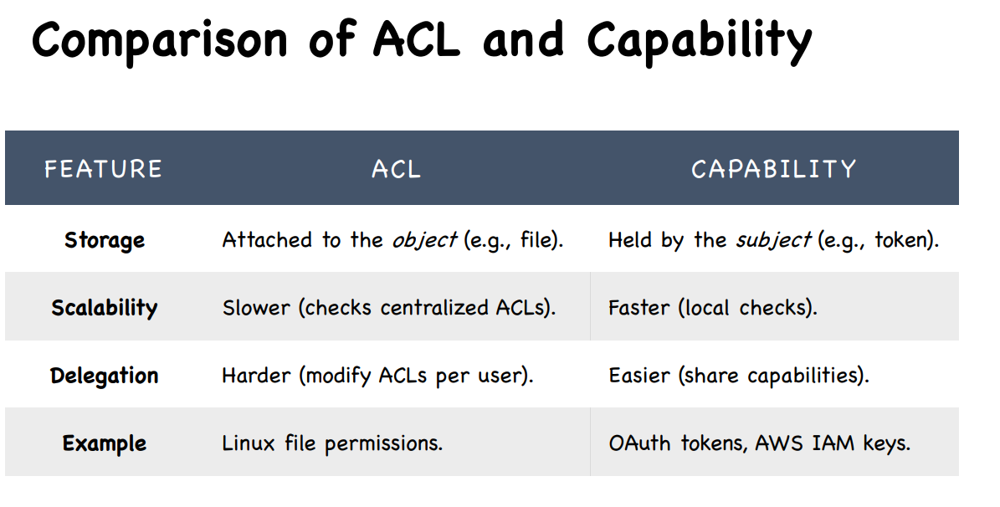

3. Trusted execution environment（TEE）

   **TEE（可信执行环境）** 是现代 CPU 提供的一种**硬件/软件安全扩展**。

   核心技术包括

   1. **CPU 隔离**

      外部软件（包括 OS、VMM）**无法访问** TEE 内部的内存、寄存器和 CPU 缓存。

   2. **内存加密**

      TEE 使用**硬件加密引擎**对物理内存进行**动态加密**，密钥由硬件生成与管理。

   3. **远程证明（Remote Attestation）**

      允许用户通过 CPU 提供的**硬件信任根（Root of Trust）**来验证 TEE 中运行软件的初始状态是否可信。

### System Hardening

1. Vulnerability discovery

   发现软件的bug/vulnerabilities 技术包括如下

   1. Program analysis
      1. Static Analysis: Analyze source code without execution
      2. Dynamic Analysis: test running applications
      3. Hybrid Approaches
   2. Fuzzing is a technique to discover bugs by injecting random, malformed, or unexpected inputs into software.
      1. Input Generation Strategy: 
         1. Mutation-Based: Modifies existing inputs (e.g., bit-flipping)
         2. Generation-Based: Creates inputs from formal specifications
      2. Feedback Mechanism: 
         1. Coverage-Guided: Uses execution traces (e.g., branch coverage) 
         2. Black-Box: No program feedback
         3. Grey-Box: Lightweight instrumentation
      3. Target Knowledge: 
         1. White-Box: Uses program analysis (concolic execution) 
         2. Black-Box: No internal knowledge 
         3. Hybrid: Combines static/dynamic analysis

2. Exploit prevention（漏洞利用预防）

   Prevent vulnerable software from successful exploitation, after they are deployed in the system

   1. Address Space Layout Randomization (ASLR)

      ASLR is a security technique that randomizes the virtual addresses of system and application components (e.g., stack, heap, libraries)

   2. Stack Canary

       在函数调用栈中插入特殊值（Canary），在函数返回前验证它是否被篡改。

       A runtime security mechanism that detects buffer overflows by placing a random value between the stack variables and the return address(Compiler-Inserted Guard, Overflow Detection)

   3. Control Flow Integrity (CFI)

      限制程序只能按照预期的控制流路径执行。

      CFI is a security mechanism that restricts program execution to valid control-flow paths, preventing exploits like: • ROP (Return-Oriented Programming) • JOP (Jump-Oriented Programming) • Call/return hijacking

      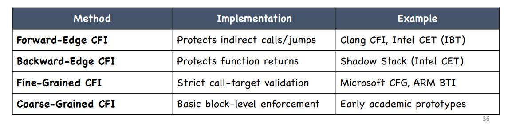

      **CFI（控制流完整性）** 是一种**防止代码重用攻击（如 ROP）**的重要安全机制。其目标是**确保程序的控制流执行不会被恶意篡改**，即只能跳转到合法的目标地址。

      CFI需要Hardware support: Intel CET, ARM BTI

### Detection

1. Malware detection 恶意软件检测

   Goals: identify and mitigate malicious software (malware) that can harm systems, steal data, or disrupt operations.

   Types of malware includes: viruses, worms, Trojans....

   Detection techniques includes: Signature-Based, Heuristic-Based, Behavioral Analysis, Machine Learning-Based Detection...

2. Host-based intrusion detection(基于主机的入侵检测，HIDS)

   Monitors and analyzes activities on a single host to detect potential intrusions or malicious activities.

   Key components: Event Sensors, Event Analyzers, Response Mechanisms

   Techniques include: Signature-based, Anomaly-based, Behavioral Analysis...

3. Network Security in a Nutshell

   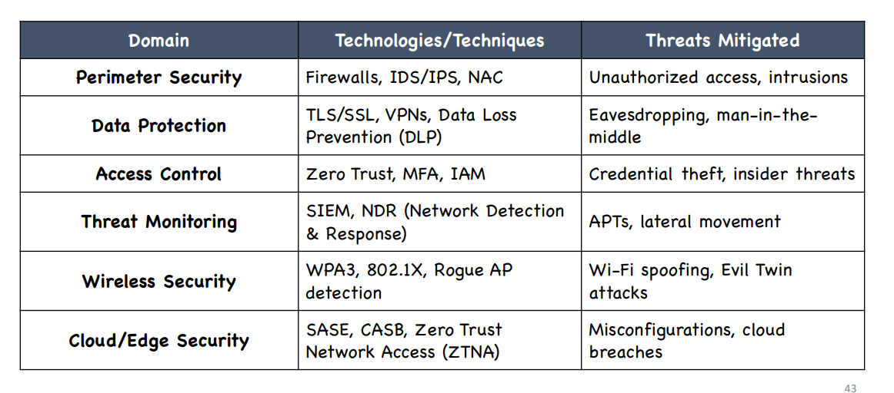

   Applied Cryptography in a Nutshell: Data Confidentiality, Data Integrity, Authentication

## Tips

### Security

1. Isolation

   1. Software: 
      1. SFI: memory sandboxing, Control-flow restriction, Instruction-level Sandboxing
      2. eBPF: Load -> verify -> attach -> run
   2. Hardware: Intel Memory Protection Keys (MPK)

2. Access control: 

   Key components: subjects(user/process), objects(file/devices), permissions(read/write/execute)

   Implementation: Access control matrix, Access control list, Capacity(list of tokens held by subjects)

   Discretionary Access Control (DAC), Mandatory Access Control (MAC), Capability

   Capability is as following:

   1. Key working-flow: Issuance, Access Request, Validation, Action
   2. Key properties: **unforgeable, delegable, self-describing, no global checks**

3. Vulnerability discovery: 

   1. Program analysis: Static Analysis, Dynamic Analysis, Hybrid Approaches
   2. Fuzzing: Input Generation Strategy, Feedback Mechanism, Target Knowledge

4. Exploit prevention（漏洞利用预防）: ASLR, Stack canary, CFI

5. Detection: Malware detection, Host-based intrusion detection

### File system

1. 有四个components: Naming, Disk Management, Protection, Reliability/Durability

2. Linked Allocation 思想是chop storage device and data into equal-sized blocks，但是每个block需要4 bytes作为指针指向下一个block 

   FAT series中一般有下面这些东西

   1. FAT(file allocation table) 管理所有的block以及指针对应关系

   2. Directory存储start cluster number, file size, all file attributes...

      LFN directory entry 支持更长的文件名

   3. FSINFO记录free cluster的个数以及next free cluster

   FAT32 stores file names and attributes in the directory entries.

3. iNode Allocation(Unix File System)包含file metadata, direct pointers, indirect pointers, double indirect pointers, triple indirect pointers

   Ext 2/3 file system is divided into block groups and every block group has the same structure

   Ext2/3 file system stores the file name in the directory entries, and the file attributes in the inode. 

   1. Layout: superblock, group descriptor table, block bitmap, inode bitmap, inode table, data blocks
   2. hard link本质是创建一个新的目录项，指向相同的inode
   3. soft(symbolic) link本质是拆功能键一个新的inode，然后这个inode指向的东西和原来的inode是一样的

4. Memory Mapped files OS允许那个文件映射到地址空间；传统IO读写文件时候显式调用系统调用

### Storage

1. Storage Devices: Magnetic disks, Flash memory

2. Read sector from random place on disk: seek + rotate + transfer

   Read sector from random place in the same cylinder: rotate + transfer

   Read next sector on same track: transfer 

3. Disk scheduling: FIFO, SSTF, SCAN, CSCAN, LOOK, CLOOK

   注意SCAN到另一边是到最远点就停止了；CSCAN到中间时候也是到临界点前就停止了

### I/O

1. IO有三个challenges: Diverse device, Unreliable device, Unpredictable and slow devices

2. Interrupts

   1. Hardware support: Interrupt-request line 中断请求线, Interrupt-controller hardware 中断控制器
   2. Software support: Interrupt handler 接收中断

3. Programmed I/O

   1. Two approaches to control devices: Explicit I/O instructions, Memory-mapped I/O

   2. More Efficient Data Movement: DMA(Data Memory Access)

      一个独立的数据传输单元： CPU先设置DMA控制器（指定 源地址、目标地址、字节数等），然后DMA控制器直接控制内存和设备间的数据传输，DMA 控制器临时掌控总线访问权，进行cycle stealing（抢CPU的时钟周期）来完成传输，完成之后interrupt

   3. Device Driver: 设备驱动是内核中一部分代码，用于直接与硬件交互。提供标准接口隐藏设备差异

      Top half driver: 相应系统调用，Bottom half driver: 处理中断，唤醒等待的进程

   4. Broadly I/O devices can be grouped by the OS into • Block I/O • Character I/O (Stream) • Memory-mapped file access • Network sockets

### Deadlock

1. Deadlock可以带来Starvation, Starvation无法带来Deadlock

2. Deadlock 4 requirements: Mutual exclusion, hold and wait, no preemption, circular wait

3. Deadlock detection: 检测当前状态是否有deadlock

   If detected: terminate process, force it to give up; preemption; roll back

4. Deadlock prevention: 确保至少一个requirement不满足

5. Deadlock avoidance: 动态判断这一资源分配会不会导致deadlock，引入prior information进行分析之后进行调整

   Banker's Algorithm: 先通知系统自己的max allocation是多少(估计)，然后如果请求的 资源小于available并且分配之后还是safe state那么就分配给他

   Tip: 检查是否安全不能用request resource来计算，需要使用max来计算

### CPU Scheduling

1. Two types of processes: CPU-bound process(user-time > sys-time), I/O-bound process(sys-time > user-time)

2. Algorithms

   1. SJF: non-preemptive, preemptive

   2. RR: preemptive

      The responsiveness of the processes is great under the RR algorithm.

      注意quantum用完的process和一个新的process同时进入队列时候旧的应该放前面

   3. Priority scheduling: non-preemptive, preemptive, static priority and dynamic priority

   4. CFS

      nice<0 vruntime 将会increase by less than its real time.

      当需要选择下一个task时候系统会选择smallest vruntime value的那个任务

### Synchronization

1. Race condition可能发生的条件：shared object, multiple processes, concurrently

   结局方案就是Mutual Exclusion: when one process access the shared memory, no one else could access it

2. Critical section is the code segment that is accessing the shared object.

3. Critical Section Implementation: Mutual Exclusion, Bounded Waiting, Progress

   1. Disabling Interrupts

   2. Spin-based locks

      Violation: Sometimes you give me my turn but I’m not ready to enter critical section yet.

      Solution: Peterson's solution 就是interested[me] = true, turn = other使用判断语句 turn == other && interested[other] == TRUE 表示需要等待 总结起来就是"让步兴趣"

      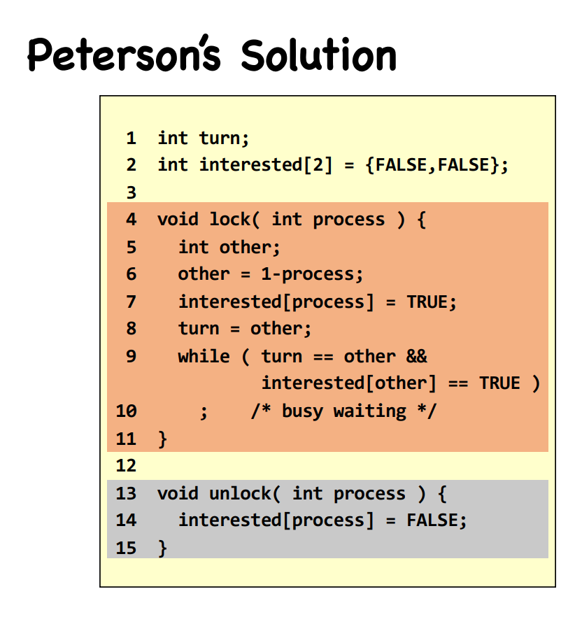

      然而扩展到Multi-Process Mutual Exclusion需要添加 test_and_set() 原子操作 它可以：以不可中断的方式读取一个值并设置它；避免多个进程同时判断自己可以进入临界区 ⇒ 确保互斥

      Priority Inversion: 低优先级处在critical region中，但是由于是preemptive导致了高优先级一直抢占了CPU 于是就阻塞了

   3. Sleep-based lock: Semaphore（Counter表示资源数量，waiting-list）必须涉及内核

      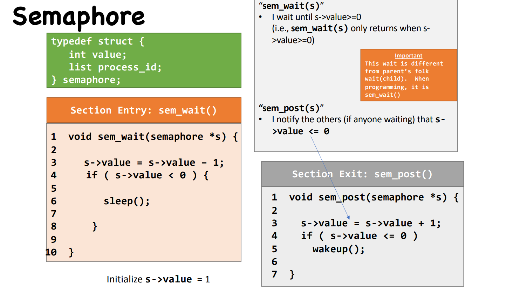

      Usages

      1. Producer-Consumer Problem

         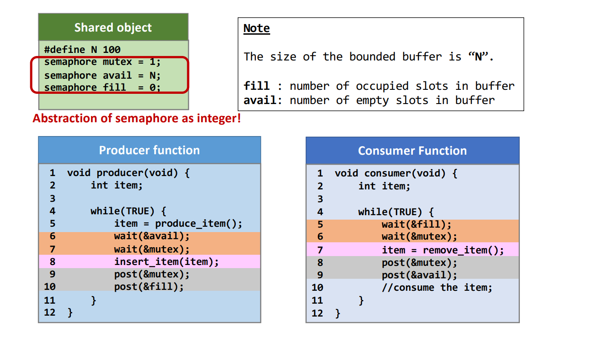

      2. Dining Philosopher Problem

         Final Solution: 每个哲学家有三个状态: HUNGRY, THINKING, EATING，过程大概是这样的：一 个人开始吃之前(HUNGRY)会询问左右边在不在吃，如果都不在就直接开始吃；只要有一个 人开始吃了，那captain就会告诉他不能开始吃，就开始等待wait(&p[i])，当有人吃完了就会通过captain通知左右的人，然后captain就唤醒post(&p[i])，那个人就可以开始吃了。

         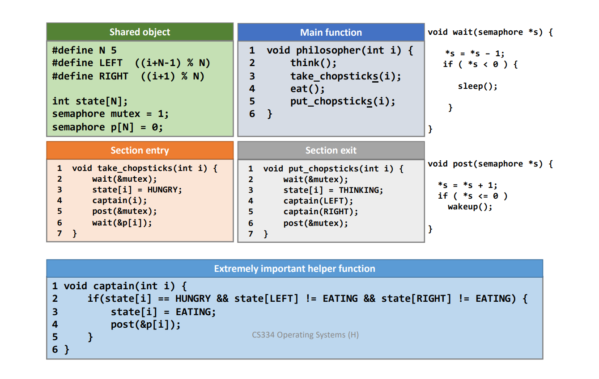

