# CS302 Operating System Midterm Review

Name: Changxin (Daniel) Chen

## L01 Intro

讲了几个概念

### Process

1. A process(进程) is a program in execution
   - Program is a passive entity and process is an active entity.

### Process Management 

进程管理就是管理进程的create, delete, 以及进程之间的communicate等

### Memory

1. DRAM (Dynamic Random Access Memory) is the main memory used for all devices such as laptops. 
2. OS dictates which process can access which memory region.
3. CPU在执行时候只跟main memory直接interact.

### Memory Management

1. Memory management determines what is in memory when 
   - Optimizing CPU utilization and computer response to users
2. 内存管理keep track哪些memory region被who所用，决定which process和数据移动或移出内存

### Storage Management

存储管理 不同于内存管理 指的是storage unit的管理比如file-system management

### I/O Subsystem

I/O Subsystem 负责管理和协调输入/输出设备与CPU、内存之间数据交换的模块，主要是和外部设备的交互

memory management of I/O including: buffering, caching.

###  Protection and Security

系统的保护机制，decide which user can access to which part of information

## L02 OS Basics

### Computer System

1. von Neumann architecture

   1. single shared memory for programs and data
   2. single bus for memory access
   3. an arithmetic unit
   4. a program control unit

2. Structure

   Hardware + OS + Application programs + Users

#### Operating System(OS)

1. OS includes a software program : **Kernel**

   It manages all physical devices(CPU, RAM...), exposes some function such as system calls

2. OS includes other "helper" programs

   shell, GUI, Browser...

3. OS is a resource manager, manage CPU, memory...

4. OS is a control program

5. OS do

   1. Virtualization: 抽象硬件，每个进程有独立的虚拟地址，互不干扰
   2. Concurrency: 协调各个进程或线程正确高效执行
   3. Persistence: 持久性，把memory中的东西保存到storage，避免崩溃导致数据丢失

6. OS revolution

   early -> Atlas -> UNIX -> PC era -> Smart phones

7. Dual-mode operations

   1. Kernel-mode vs User-mode (traditional CPU architecture)

      1. kernel-mode 可以直接访问所有系统资源，不受限制
      2. user-mode 普通应用程序运行的受限模式，无法直接访问硬件或关键系统资源

      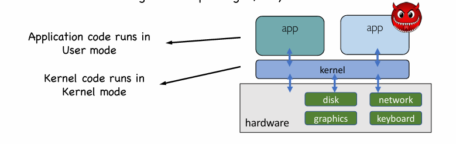

   2. RISC-V CPU modes

      1. User Mode 只能访问自己的虚拟地址空间
      2. Supervisor Mode 可以管理用户进程、虚拟内存，不能直接控制硬件
      3. Machine Mode 能直接控制硬件，管理 CPU 的所有资源

   3. Mode transitions

      1. System Call

         1. Between user mode and kernel mode, written in a high-level language
         2. Types: Process control, File management, Device management, Information maintenance, Communications, Protection
         3. User mode 切换到 kernel mode处理请求，然后将结果返回给用户进程，模式切换回user mode

      2. Interrupt(**asynchronously** preempt normal execution)

         **外部设备或定时器**触发的异步事件，导致 CPU 停止当前工作，**切换到内核模式**，处理中断服务程序

      3. Trap or Exception(**synchronous** react to an abnormal condition)

         **CPU 执行指令时**发生的异常事件，导致模式切换到内核模式，进入异常处理程序（Exception Handler）

8. Kernel Structures

   1. Monolithic Kernel （宏内核）

      宏内核是一种将**操作系统的所有核心功能**（如进程管理、内存管理、文件系统、驱动程序等）**集成在一个大模块中**并在**内核空间**中执行的内核架构 比如linux, unix等

   2. Micro Kernel （微内核）

      微内核**只保留核心功能**（如**进程管理、内存管理、进程间通信**），其他服务（如文件系统、驱动、网络协议等）作为**用户空间的独立进程**运行 (for flexibility)

      1. Pros: more responsive, better stability and security (less code in kernel)
      2. Cons: More IPC(Inter-process communication) needed (slower), Portability issues(App APIs may differ)

   3. Hybrid Kernel（混动内核）

      Combination of two kernel types above, e.x. Windows OS

   Hypervisor (virtual machine manager (VMM), 虚拟机监视器) : virtualization and isolation

9. OS design

   User goals & System goals

   OS separates policies(which software could access which resource...) and mechanism(how is the policy enforced). This separation is important for the flexibility.

10. OS Services

    1. OS services provides functions that are helpful to users (between User and OS):

       1. User Interface
       2. Program execution
       3. I/O operations
       4. File-system manipulation
       5. Communications
       6. Error detection
       7. Resource allocation
       8. Accounting
       9. Protection and security

    2. User Operating System Interface

       1. Command Line Interface(CLI)
       2. Graphic user interface(GUI)

    3. System Programs

       File manipulation, status information, file modification...

## L03 Processes

### Process and system calls

1. 每个process有unique PID, which is used for process identification

2. Process Life Cycle

   ​	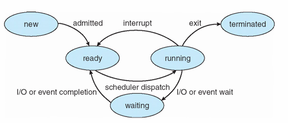

3. **System call**: Process-Kernel Interaction (Call by number)

   1. Parameter Passing

      Three general methods used to pass parameters: 

      - Registers: pass the parameters in registers
      - Blocks: Parameters stored in a memory block and address of the block passed as a parameter in a register 
      - Stack: Parameters placed, or pushed, onto the stack by the program and  popped off the stack by the operating system

   2. System Call VS Library API Call

      Most OSs provide standard C library to provide library API calls

      printf, scanf, malloc, free, fpen, fclose并不是system call(而是library call)，mkdir, rmdir, chown, chmod是system call.
      
      比如C中API call `fopen()`实际上是invoke system call open()，因为open() too primitive and not programmer-friendly

### Process Creation

1. Create process using **fork()**, we call it the child process

   - fork() behaves like “cell division”, it creates the child process by cloning from the parent process.
- Both parent and child need to return from fork(). 相当于child process是从`result=fork()`这里copy的，从这一句开始执行
   - CPU scheduler decides which to run first.
   - For parent, the return value of fork() is the PID of the created child.
   - For child, the return value of fork() is 0.
   - fork clone的包括 program counter(CPU register), program code, memory, opened files.

2. **Exec()** call family, execl()

   - For example run the command `"/bin/ls -l"`:  `execl("/bin/ls", "/bin/ls", "-l", NULL);`
   - However, it **cannot** get back to the old program after "invoke" a command. **The “return” or the “exit()”  statement in “/bin/ls” will terminate the process**… Therefore, it is certain that the process cannot go back to the old program!
   - The process that calls an exec* system call will replace user space info. e.g. Program Code, Memory, Register value...

3. **wait()** suspends the calling process to waiting
- wait() returns when one of its child processes changes from running to terminated. 就是wait直到当他的一个子进程状态从running 变成 terminated；当然显然如果没有children或者一个child在parent call wait之前就已经terminated了，那么wait就会立刻returen
   - waitpid() returns depending on the parameters, waitpid() will wait for a particular child only，即在这个child返回之后进入parent进程

### Process: Kernel View

1. Process Control Block(PCB) stores information associated with each process ★

   Process state • Program counter • CPU registers • CPU scheduling information • Memory-management information • Accounting information • I/O status information

   - PCBs are linked in multiple queues

     Ready Queue contains all processes in the ready state, and device queue contains processes waiting for I/O events from this devices

2. Threads (线程), 一个process可能有多个threads

3. Switching between processes 进程之间的切换

   1. 当process 在CPU上执行的时候，发生system call or exception or interrupt时候，控制权交还给CPU(如果很长时间没有发生这些时候，要么OS wait，要么timer interrupts, which is also what the modern OSs choose to do.)
   2. 当OS kernel重新获得control of CPU时候，首先complete the task(exception or system call..), 然后decide哪个process接着执行 （by asking its CPU scheduler）
   3. 如果即将执行的进程与之前运行的进程不同，OS会执行一次上下文切换（context switch）
      - the system must save the state of the old process and load the saved state for the new process
      - 上下文切换的时间属于额外开销，时间长短决定于hardware support，所以上下文切换不能too frequent.

### fork(), exec(), wait() Kernel View

1. fork(): kernel view

   1. 在user mode中使用fork()实际上kernel会先创建一个新的PCB给新的子进程，只有PID和pointer会略有不同
   2. 他们首先会使用**duplicate address space**，先共享相同的代码（只读状态），只有在任意进程尝试修改内存时候，kernel才为修改的哪一方创建独立的副本(**Copy on Write**) 这样为了提高效率

2. exec(): kernel view

   kernel会问管理当前进程的现有资源，因为exec()会替换当前程序映像，然后会把user space替换成新程序的数据

3. wait(), exit(): kernel view

   1. exit()时候kernel

      1. 释放most of the **allocated kernel-space memory**, list of opened files are all closed.  因为父进程这时候还不知道，需要让父进程直到child已经退出了，所以后续需要通过父进程的wait让他自己回收一下内存
      2. Then, the kernel frees everything on the **user space memory** about the concerned process, including program code and allocated memory. Process ID依旧保留在kernel的process table，status会变成 **Zombie**
      3. 最后，然后kernel 会发送一个SIGCHLD signal给parent告诉parent那个child已经terminated了

   2. wait(): kernel view

      Process直接的沟通是通过SIGCHLD, 它是由内核发送给父进程的信号，用于通知父进程其某个子进程的状态发生了变化，一般情况下父process不会回复，除非he is waiting for the child，那么kernel 会register a **signal handling routine** for that process，然后kernel 会 

      - Accept and remove the SIGCHLD signal;
      - Destroy the child process in the kernel-space (remove it from process table, task-list,  etc.), 相当于一个"exit()"
      - deregisters the signal handling routine for the parent.
      - returns the PID of the terminated child as the return value of wait()

      通过这个过程, child就会clean death because of wait() system call.

      如果parent的wait是在child exit之后，那么在parent wait时候 kernel 会立刻set signal handling routine,发现SIGCHLD已经在那里，然后就会take action immediately. 那么也就意味着在parent wait之前会一直存在一个zombie

4. wait() for resource management

   zombie process 应该及时清理

### More about Processes

1. 父进程如果退出了，
   1. Linux: 那么子进程会被“init”进程(PID=1) 收养，也就是re-parenting(Linux)，具体过程就是在parent的exit() system call中会把他的所有children中parent的pointer指向自己的parent.
   2. windows: 会保持这个forest-like的结构
2.  The re-parenting operation enables something called **background jobs** in Linux
3. User Time VS System Time
   1. User time是CPU time spent on codes in **user-space** memory
   2. Sys time是CPU time spent on codes in **kernel-space** memory
   3. real > user+sys -> I/O intensive; real < user+sys -> multi-core

### Threads

1. Thread is an **abstraction** of the execution of a program
2. Each thread has its own **private** execution state
3. Threads in the same process **share** computing resources
4. User thread: OS does not know about user thread
5. Kernel thread: OS is aware of each kernel thread
6. Thread Models (kernel thread)
   1. Many-to-one mapping
      - Pros: Context switch between threads is cheap
      - Cons: 当一个thread阻塞，all threads block
   2. One-to-one mapping
      - Pros: 每个thread可以run or block independently
      - Cons: 需要make a crossing into kernel mode to schedule
   3. Many-to-many mapping （kernel threads number is relatively small）
      - Pros: best, more flexible
      - Cons: hard to implement

## L04 Address Translation

### Multiprogramming

1. Time sharing: OS switches between multiple processes
2. Memory Partition
   - 每一个process有自己的一块physical memory存储空间
   - issues就是需要空间扩展，以及process很难知道自己未来会需要多少空间

### Address Space

1. From bottom to top
   1. Code segment (instructions at the bottom)
   2. Stack segment (local variable, arguments, return values)
   3. Heap(malloc)

   stack and heap need to grow
   
2. Memory Virtualization

   每个process有自己的virtual address Translation即virtual -> physical

   1. transparent: invisible to processes
   2. efficient: fast translation, not too much space consuming
   3. protection: enable memory isolation

### Address Translation

coordinate between CPU hardware and OS software

1. Fetch instruction at VA.
2. Through MMU(Memory Management Unit) we get PA and fetch it
3. CPU executes, access VA and translate into PA and find it again from that PA

### Translation Detail

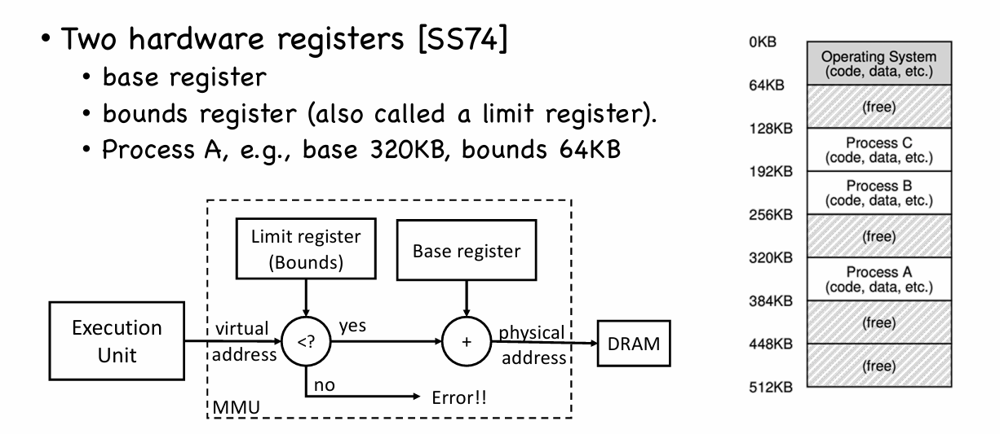

1. Limitation of Base & Bounds
   1. Internal fragmentation: waste memory between heap and stack
   2. 不支持larger address space(at most ...KB)
   3. hard to do inter-process sharing

2. Segmentation(Each segment mapped to a different region of the physical memory，实际上是generalized形式的B&B方法): Implementation

   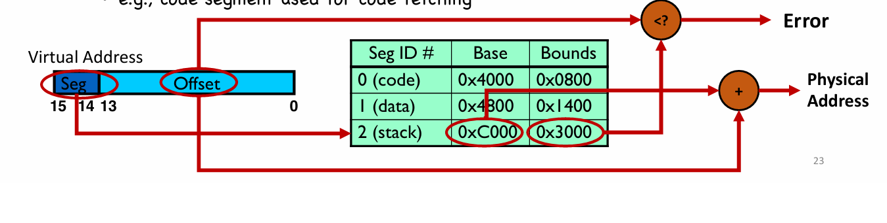

   Base/bounds registers organized as a table

   Use segments explicitly: Segment addressed by top bits of virtual address

   Use segments implicitly: e.g. code segment used for code fetching

   Problems:

   1. OS context switch must also save and restore all pairs of segment registers
   2. A segment may grow, which may or may not be possible
   3. Management of free spaces of physical memory with variable sized segments
   4. External fragmentation: free gaps between allocated segments(Segmentation may also have internal fragmentation if more space allocated than needed)

   Internal fragmentation: spaces between heap and stack may be wasted

   External fragmentation: free spaces are curved into small chunks(each is too small for further allocation)

3. Memory Allocation

   1. Best fit(找一遍free list找到最小的可以放置的放进去，好处就是最优的，但是search过程slow)
   2. Worst fit(找一遍选择最大的拿出来使用，避免产生太多的小碎片，坏处就是也会导致碎片化和search slow)
   3. First fit(找到第一个足够大的，好处就是fast，坏处就是导致free list开始的地方碎片化)

## L05 Paging

### Introduction to paging

为解决碎片化问题，尝试把内存切成固定大小的块，用位图管理，就可以避免外部碎片的问题，也让分配更简单高效。那么Paging 就是put all these ideas together

1. PM divided into fixed size, each is called page frame
2. VA space divided into the same size, each is called page
3. page mapped to page frame(1-1 or many-to-one which is memory sharing)
4. one page table per process:  页表(page table)记录了这个进程中每个“虚拟页”应该映射到哪个“物理页帧”。页表存储在物理内存中，页表中的每一项（entry）负责把一个虚拟地址转换为物理地址

Page Table Entry(PTE), including valid bit, protection bits(permission to read, write, execute), access bit(whether a page has been accessed), dirty bit(whether the page has been modified since it was brought into memory), present bit(page in PM or disk) 

PT size: if 32-bit machine and 大小为4KB pages 每个PTE是4个bytes(PFN加上status bits), $2^{20}$ PTEs, so size of PT is $4*2^{20}$ = 4MB

### Multi-level Page Tables

多级页表的翻译

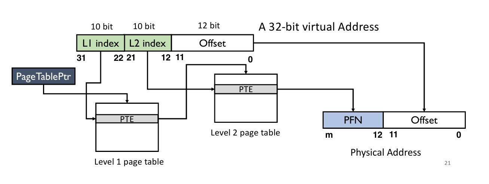

### Other Page Table Structures

1. Hierarchical page tables(2, 3, 4 level page tables)
2. Hashed Page Tables
   1. Hash function: input VPN, output index in the hashed page table
   2. collision handling: linked list, each element consists VPN, PFN, pointer to the next element
3. Inverted Page Tables
   1. One page for whole system
   2. each entry 对应一个physical page frame(process ID and VPN)
   3. page查找需要entire table的linear搜索
   4. hard memory sharing

### Real-world paging schemes

1. SV39(Page size 4KB, VA: 39 bits(remaining bits of total 64 bits reserved), PA: 56bits)

   1. Three levels of page tables

      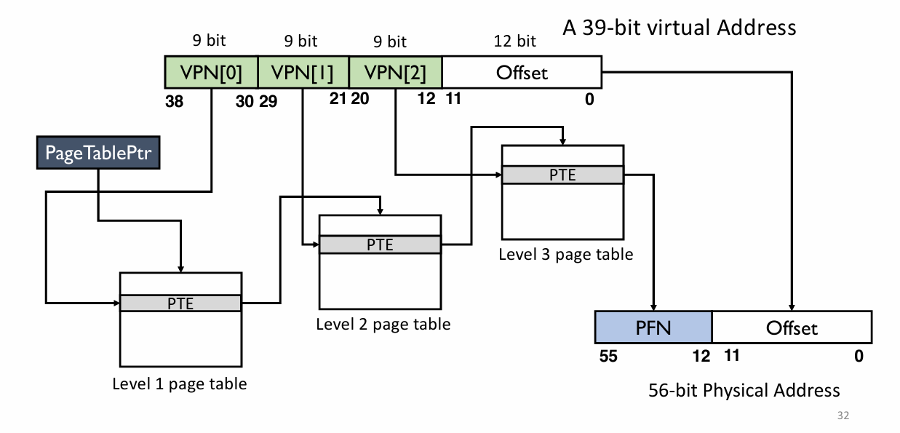

   2. PTE 8 bytes(8-0 status bits, 53-10 PFN, 63-54 reserved)

      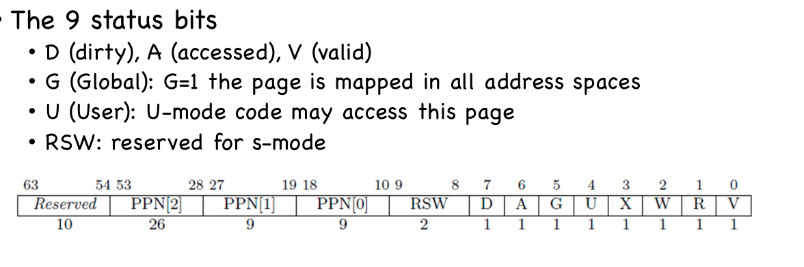

2. IA-32

   Intel 32 bit CPU IA-32 uses 2-stage address translation: segmentation + paging

   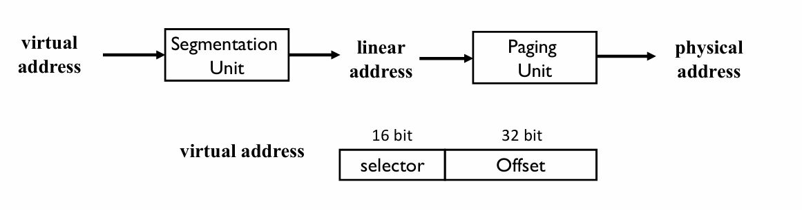

   2 descriptor tables: GDT AND LDT

### Translation Lookaside Buffer

motivation是paging时候time complexity的问题，extra memory在地址翻译中的问题以及多级页表需要多次的memory read，那么如何speed up？

TLB是hardware cache(MMU的一个部分)，PTE的cache，保存着to re-used的对应关系，replacement policy(LRU, FIFO, random)

TLB hit: VPN found, PFN of the same entry used; TLB miss: VPN not found, page table walk

TLB能够work的原因是TLB smaller than page table但是依赖spatial locality and temporal locality

上下文切换的问题，解决方案是在切换之后清空TLB，所有条目标记为invalid 或者 使用扩展TLB（address space ID）,给每一个进程分配ASID，这样不需要清空TLB

## L06 Demand Paging

### Demand Paging Mechanism

引入的motivation是为了 support larger address space, 使用按需paging机制，不常用的放在disk swap space即可

paging是按需加载的，当他被需要时候会从disk to memory. disk上面有swap space (OS 临时存储创建的disk上的page), 以及program binary files(code page当在他们执行时候才会被load to memory, 一直是read-only, never write back)

所以PM也可以看作一个cache:

1. block size 1 page(4KB)
2. fully associative cache organization(any disk page maps to any page frame)
3. LRU, Random, FIFO
4. If miss, go to lower level to fill page (i.e. disk)
5. write-back: changes are written back to disk when page is evicted (应该是会立刻写回如果dirty = 1)

Page faults: present bit = 0 -> page fault exception, 操作系统介入进入handler开始流程

1. find a free page frame

   If no free page, trigger page replacement

2. load page from disk（swap space存的是被replace换回来的page）

3. 更新页表，present bit = 1，填写新的PFN

4. 重新执行指令，TLB entry loaded from PTE

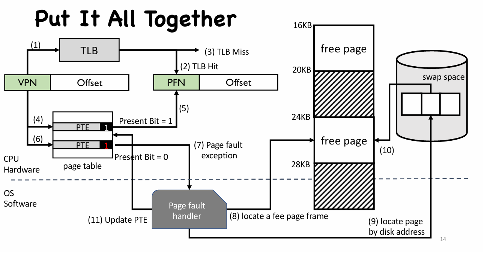

上图反映了整个过程的逻辑，包括TLB, page, page fault的处理情况

Page Replacement 当物理内存满了，还要加载新的页面时，必须“腾个地方”出来

1. **提前**置换页面，**不是等到有人需要空页框了才换**。这样可以避免当系统突然要大量加载页面时，内存不够用，卡顿严重。方法是系统始终预留一些空闲页框，如果空闲数低于一个阈值，就提前触发页面置换

2. Swap Daemon（页面换出守护进程）

   这是一个在后台悄悄运行的系统进程，它的任务就是：一边监控内存状态，一边判断是否该开始“换页”。

   它使用两个阈值来做决策：

   1. 如果空闲页框数 < Low watermark ➜ **触发换页**：开始把不常用的页从内存中移到磁盘（腾位置）
   2. 如果空闲页框数 ≥ High watermark ➜ **停止换页**：说明内存已经足够空，先别动了

### Page Replacement Policy

EAT(Effective Access Time) = Hit Rate x Hit Time + Miss Rate x Miss Penalty

1. Cache miss types

   1. Compulsory miss 从未加载过的miss -> prefetching
   2. Capacity miss 容量不足的miss -> 增加DRAM, 动态调整内存比例
   3. Conflict miss 多个数据映射到同一个位置（非完全相联缓存才有）

2. Policies

   1. Optimal(MIN): 替换未来最长时间都不会使用的page, leading to minimum page faults
   2. FIFO: 丢弃oldest page first 但是可能会丢弃常用的
   3. random: 随意替换，很难guarantee
   4. LRU(least recently used) 替换以前最长时间没有用到的, temporal locality of program
   5. LFU(least frequently used) 替换使用次数最少的, spatial locality of program

   Belady's Anomaly: 本来应该增加内存缺页率下降 LRU，MIN确实如此，但是FIFO有时候甚至可能导致page fault变多

   LRU Implementation

   1. Hardware support: update data structure every memory access(timestamp)
   2. Overhead:
      1. additional memory write for each memory access（即使命中了TLB也要告诉OS命中了这个page）
      2. scan entire memory to find LRU（scan or sort）

   LRU Approximation 使用reference bit 近似实现LRU 即用used 和 unused来标记

   1. Clock Algorithm

      页面排成一个“环”（像时钟一样）; 一个“指针”一格一格走

      如果碰到一个引用位 = 1 的页面，就把它的引用位清零（相当于给它第二次机会），然后继续走

      如果引用位 = 0，就把它换掉

   2. Enhanced Clock Algorithm

      在引用位基础上，**再加一个 dirty bit（是否被修改）**

   3. Approximation using Reference bit and Counter

      reference bit set by CPU hardware, cleared by OS; Counter maintained by OS

      1. Additional-reference-bits Algorithm
         1. 使用8位寄存器记录历史 + reference bit
         2. 100ms定时中断，把ref bit移进历史 (相对于clock有更频繁地中断)
         3. 8位寄存器当作无符号数越小表示越久没用
      2. Nth-chance Clock Algorithm
         1. 扫到某个页面如果是1把这个页面全部清零; 如果是0那么计数器+1，如果到了N就换掉这个页
         2. N太大准确率高但效率低；太小不容易保留有价值的页但效率比较高

### Page Frame Allocation

给不同的process应该怎么分配page frame

Page Frame Allocation

1. minimum number of pages per process 最少需要几页
2. ###### maximum number of pages per process 多个进程一起使用，总页数固定

Global allocation: 和所有page frame进行replacement, process可以take a frame from another

Local replacement: 每个进程只能选择自己set里面分配的frame进行替换

Allocation Algorithm

1. Equal allocation
2. Proportional allocation
3. Priority Allocation 如果高优先级的缺页了，OS可以牺牲低优先级进程的frame来腾位置

Thrashing

每个进程不断发生page fault，系统不断页面进出，就是系统可用物理内存不足

1. Early OS: 监控每个process working set，如果工作集太大了减少进程只保留几个
2. Modern OS: 强行杀掉进程，有时候需要reboot

## L07 Linux Memory Management

1. Linux Address Space

   0-0xBFFFFFFF -> user virtual address, 0xC0000000-0xFFFFFFFF -> kernel virtual address (32 bits)

   kernel memory map -> address space of each process

   1. No need to change page table when trapped into the kernel - no TLB flush
   2. kernel code may need to access user memory

   Kernel Logic Addresses

   1. most kernel data structures(page tables, per-process kernel stack, kmalloc()（kmalloc用于分配物理地址连续的小块内存）)
   2. map to continuous physical address

   Kernel Virtual Addresses

   1. virtually continuous memory
   2. vmalloc() 用于分配虚拟上连续，但物理地址不一定连续

   U = 1: User mode code may access this page

2. Large Page Support (x86 support 4KB, 2MB, 1GB pages)

   Fewer TLB misses, Different level of page tables

3. Linux Physical Memory Management

   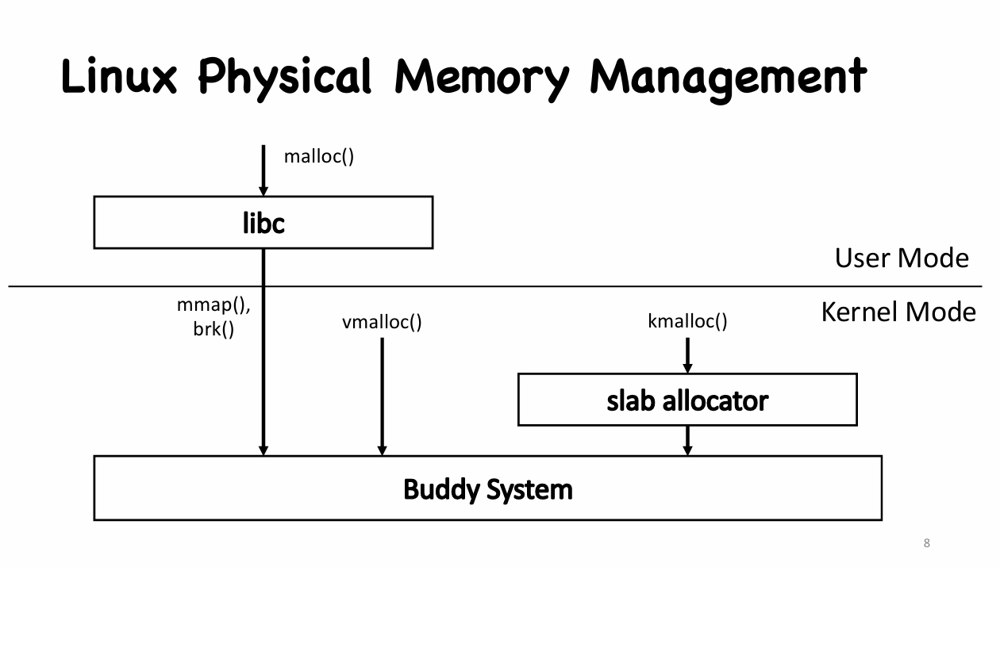

   Slab Allocator 是一种 **内存缓存机制**，用于高效分配小对象（比如结构体、缓存等）, 

   1. 避免频繁使用buddy system 带来的碎片问题和性能开销
   2. slab包括一块或多块物理上连续的页面, 一个cache包括一个或多个slab
   3. 每个type的kernel object都有专属的一个cache
   4. A request is first served by a partial slab, then empty slab, then a new slab can be  allocated from buddy system

   Buddy System 是linux最底层的物理内存分配器，把物理内存按 2 的幂次切分成不同大小的块，按需合并或拆分，所有高层分配器(slab, vmalloc)都会调用它来获取物理页

   Two buddy blocks have physical addresses that differ only in **1 bit**.

4. Page Cache

   1. 用一部分物理内存来缓存文件内容
   2. 程序文件和库不是直接运行在硬盘上，而是**通过 page cache 加载进内存再运行的**
   3. 页缓存会跟踪每一页是否是 **干净（clean）** 或 **脏（dirty）** 的，如果是脏的必须写回磁盘，但是不会立即写回，而是定期由pdflush写回
   4. Replacement Policy (2Q policy 两个队列)
      1. 第一次被访问，加入inactive list，再次被访问提升到active list
      2. 替换时候只从inactive list中删除
      3. active list如果太大，linux会周期性的把active list底部的一些页面移回inactive list, 保持active list 约等于整个page cache的2/3
      4. inactive 中的replacement使用clock algorithm 来估计approximate LRU

5. Data Execution Prevention(DEP)

   DEP is a security feature that prevents data pages to be executed by software

   A page is either writable or executable (NX bit in PTE)  AND Stacks are not executable

6. Address Space Layout Randomization

   无论是 Return-to-libc 还是 ROP，攻击者都要知道**内存中这些函数或 gadget 的确切地址**，才能跳过去。

   ASLR 的作用就是：**每次程序运行时，把内存地址全部打乱**

## Lab Keys

### Bare Metal

1. CPU 的状态是通过 CSR (Control and Status Registers) 控制的，这些寄存器一般只允许高特权级的用户进行访问和修改。
2. arm64 EL0-EL3 四个特权级；x86 四个Ring Ring0代表最高特权级，运行操作系统，通常x86架构只会用到Ring0和Ring3
3. OpenSBI(Supervisor Binary Interface) is the firmware for the RISC-V computer system that is responsible for initializing the hardware environment and then jumping to the address where the operating system is located to start executing the operating system code
4. volatile表示禁止编译器对这段代码可能的更改

### Trap & Exception

1. Trap是对exception和interrupt行为的control flow转移, trap本身是同步的
2. trap处理流程中需要用到的寄存器包括: stvec, sip, sepc...
3. Trap前后需要保存context并且最后恢复，因此，我们使用汇编实现上下文切换(context switch)机制，这包含两步： 
   1. 保存CPU的寄存器（上下文）到内存中（栈上） 
   2. 从内存中（栈上）恢复CPU的寄存器
4. Assert是一个debug工具，用来确保运行时候条件是成立的
5. PLIC (Platform-Level Interrupt Controller) 是 RISC-V 平台上用于管理外部中断的 IP 核，每个外设是向PLIC通报自己有interrupt要处理

### Context Switch

1. 理解 Context 的重要性在于：当操作系统需要切换执行不同的进程时，必须保存当前进程的 Context，并加载要切换到的进程的 Context。这样才能确保进程在下次获得 CPU 时能够从之前的 状态继续执行。这个保存和恢复 Context 的过程就是 Context Switch 的核心内容。
2. Context发生的时间：
   - Time slice expiration 系统时钟中断
   - Process blocking 无法获取资源发生阻塞时候，进程主动放弃CPU
   - Voluntary Yield 进程调用 yield 系统调用，主动放弃剩余的时间片，通常用于进程感知到自己短期内无事可做时
3. 我们在 xv6 中规定：访问 struct proc(PCB) 的所有成员时，都需要在持有 p->lock 的情况下进行。我们规定：在我们持有 (holding) 一把自旋锁时：1. 该 CPU 不能被中断，2. 其他 CPU 不能同时持有这一把锁。 我们使用 acquire 和 release 原语表示 上锁 和 解锁 的动作
4. xv6 中，每个 CPU 都有一个自己的 scheduler。 scheduler 方法从不返回。它是一个 while(1) 死 循环，每次循环时，scheduler 都尝试获取一个 task，如果能执行它，那就 swtch 到该进程执行。

### Kernel Paging

1. Segmentation在现代计算机时代有诸多劣势比如要求物理内存连续、难以动态调节大小、存在碎片化的问题，所以引入了Paging

2. Paging的计算流程请参照下图

   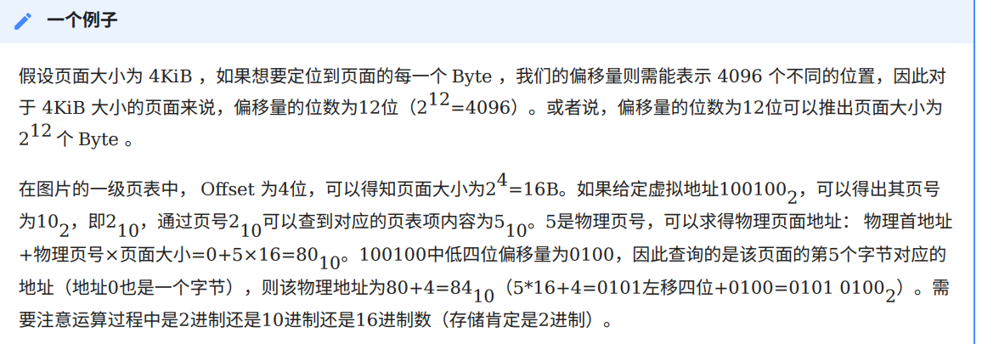

### User Space

1. 用户态与内核态之间的切换

   1. Kernel -> User

      sret指令完成需要完成对previous状态的恢复，包括SPIE, SPP, epc。只要在 sret 执行时， sstatus.SPP 为 0，我们即可降级到 U mode 下

   2. User -> Kernel

      通常包括几种方法: interrupt, exception(illegal instruction, page fault, ecall(for RISC-V))

   3. Trampoline 是两段特殊的代码 uservec 和 userret ，分别用于从用户态切换回内核态 （即用户态下的 stvec ），和从内核切换到用户态。

### User Process

几个重要的system function比如 fork(), exec(), exit(), wait()

Sleep机制

### Page Fault

1. 三种page fault类型: major(hard, 虚拟地址不在内存而在disk交换区), minor(soft, 虚拟地址没有建立映射，通常是初次访问当前页面), invalid(访问的虚拟地址不合法)

2. 内核的swap out(通常是可用物理页面过低的时候)，以及swap in(遇到page fault时候从次级存储空间读取到内存重新建立映射)

3. Swap out 算法有以下几种

   1. FIFO 先进先出，除非线性顺序访问，否则效率不高，异常现象包括belady(增加物理页有可能导致异常次数反而变多)

   2. LRU 利用temporal locality, 通过过去的访问情况预测未来的访问情况

   3. Clock algorithm 近似的LRU算法，因为相对于LRU本身，Clock实现成本低效率高，算法的思路就是维护一个指针，每次发生fault时候指针转动将use bit = 0 的那一页替换掉，将use bit = 1那一页变成0

   4. Enhanced Clock 思路类似，添加了dirty bit 那么出现4种情况 （PTE中的access(A), dirty(D)位）

      - （0，0）首先淘汰
      - （0，1）最近未被使用但是被修改过
      - （1，0）最近使用而未被修改
      - （1，1）最近使用且被修改

      但是扫描成本可能变高，因为可能要扫描很多圈

## Tips

几个可能考填空题的地方

1. OS 的 functionality, feature 

   1. Virtualization: 抽象硬件，每个进程有独立的虚拟地址，互不干扰
   2. Concurrency: 协调各个进程或线程正确高效执行
   3. Persistence: 持久性，把memory中的东西保存到storage，避免崩溃导致数据丢失

2. Mode transition有几种: system call, interrupt, exception.

3. System call 有几种type: Process control, File management, Device management, Information maintenance, Communications, Protection

4. Kernel有几种structure: Monolithic, Micro, Hybrid

5. Hypervisor (virtual machine manager (VMM), 虚拟机监视器) : virtualization and isolation

6. OS 的service 包括下列

   1. User Interface
   2. Program execution
   3. I/O operations
   4. File-system manipulation
   5. Communications
   6. Error detection
   7. Resource allocation
   8. Accounting
   9. Protection and security

7. System Programs包括

   File manipulation, status information, file modification等

8. Parameters有几种passing的方式: Register, Block, Stack

9. fork clone的包括 program counter(register), program code, memory, opened files.

10. PCB(process control block)包括下列这些信息: Process state • Program counter • CPU registers • CPU scheduling information • Memory-management information • Accounting information • I/O status information

11. Once a process runs on a CPU, it only gives back the control of a CPU 

    1. when it makes a system call 
    2. when it raises an exception 
    3. when an interrupt occurs

12. Threads三种kernel -> user的映射方法 (many-to-many, one-to-one, many-to-one)

13. Address space有下面的结构 From bottom to top, stack and heap need to grow

    1. Code segment (instructions at the bottom)
    2. Stack segment (local variable, arguments, return values)
    3. Heap(malloc)

14. 内存虚拟化有下面的特征和motivation 每个process有自己的virtual address Translation即virtual -> physical

    1. transparent: invisible to processes
    2. efficient: fast translation, not too much space consuming
    3. protection: enable memory isolation

15. Limitation of Base & Bounds 方法

    1. Internal fragmentation: waste memory between heap and stack
    2. 不支持larger address space(at most ...KB)
    3. hard to do inter-process sharing

16. Segmentation的几个问题Problems:

    1. OS context switch must also save and restore all pairs of segment registers
    2. A segment may grow, which may or may not be possible
    3. Management of free spaces of physical memory with variable sized segments
    4. External fragmentation: free gaps between allocated segments(Segmentation may also have internal fragmentation if more space allocated than needed)

    Internal fragmentation: spaces between heap and stack may be wasted

    External fragmentation: free spaces are curved into small chunks(each is too small for further allocation)

17. Memory allocation有几个方法

    1. Best fit(找一遍free list找到最小的可以放置的放进去，好处就是最优的，但是search过程slow)
    2. Worst fit(找一遍选择最大的拿出来使用，避免产生太多的小碎片，坏处就是也会导致碎片化和search slow)
    3. First fit(找到第一个足够大的，好处就是fast，坏处就是导致free list开始的地方碎片化)

18. 于是就提出了Paging, Paging就是把VA和PA都分成了等大的page, 那么page mapped to page frame有两种方法(1-1 or many-to-one which is memory sharing)

19. Page Table Entry(PTE), including valid bit, protection bits(permission to read, write, execute), access bit(whether a page has been accessed), dirty bit(whether the page has been modified since it was brought into memory), present bit(page in PM or disk) 

20. disk上面有swap space (OS 临时存储创建的disk上的page), 以及program binary files(code page当在他们执行时候才会被load to memory, 一直是read-only, never write back)

21. Swap Daemon（页面换出守护进程）

    这是一个在后台悄悄运行的系统进程，它的任务就是：一边监控内存状态，一边判断是否该开始“换页”。

22. Cache miss 三个 types

    1. Compulsory miss 从未加载过的miss -> prefetching
    2. Capacity miss 容量不足的miss -> 增加DRAM, 动态调整内存比例
    3. Conflict miss 多个数据映射到同一个位置（非完全相联缓存才有）

23. Belady's Anomaly: 本来应该增加内存缺页率下降 LRU，MIN确实如此，但是FIFO有时候甚至可能导致page fault变多

24. Reference bit set by CPU hardware, cleared by OS; Counter maintained by OS

25. Page Frame的分配

    Global allocation: 和所有page frame进行replacement, process可以take a frame from another

    Local replacement: 每个进程只能选择自己set里面分配的frame进行替换

    Allocation Algorithm

    1. Equal allocation
    2. Proportional allocation
    3. Priority Allocation 如果高优先级的缺页了，OS可以牺牲低优先级进程的frame来腾位置

26. Large Page Support (x86 support 4KB, 2MB, 1GB pages) 注意Page的size可能会考到

    Fewer TLB misses, Different level of page tables

27. Slab allocator有几个作用以及功能 Slab Allocator 是一种 **内存缓存机制**，用于高效分配小对象（比如结构体、缓存等）, 

    1. 避免频繁使用buddy system 带来的碎片问题和性能开销
    2. slab包括一块或多块物理上连续的页面, 一个cache包括一个或多个slab
    3. 每个type的kernel object都有专属的一个cache
    4. A request is first served by a partial slab, then empty slab,  then a new slab can be allocated from buddy system

28. Page Cache中 页缓存会跟踪每一页是否是 **干净（clean）** 或 **脏（dirty）** 的，如果是脏的必须写回磁盘，但是不会立即写回，而是定期由pdflush写回 

    另外，注意page cache的2Q和page frame中的替换政策不是一回事

29. ASLR 的作用就是：**每次程序运行时，把内存地址全部打乱** random the address