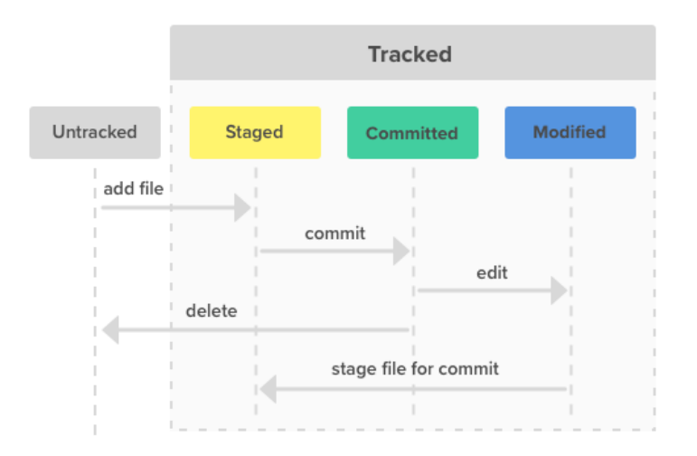
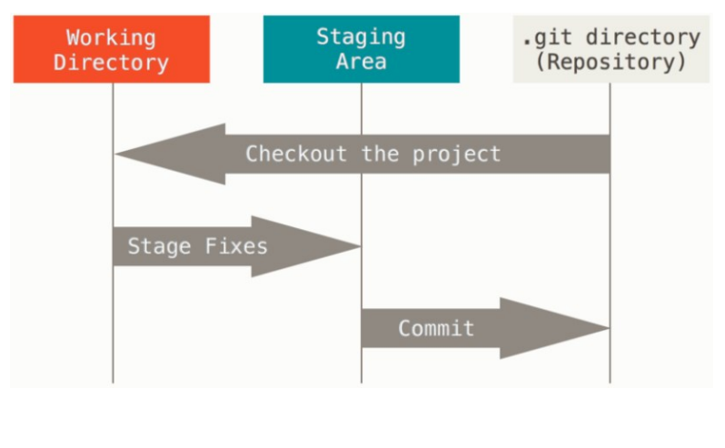
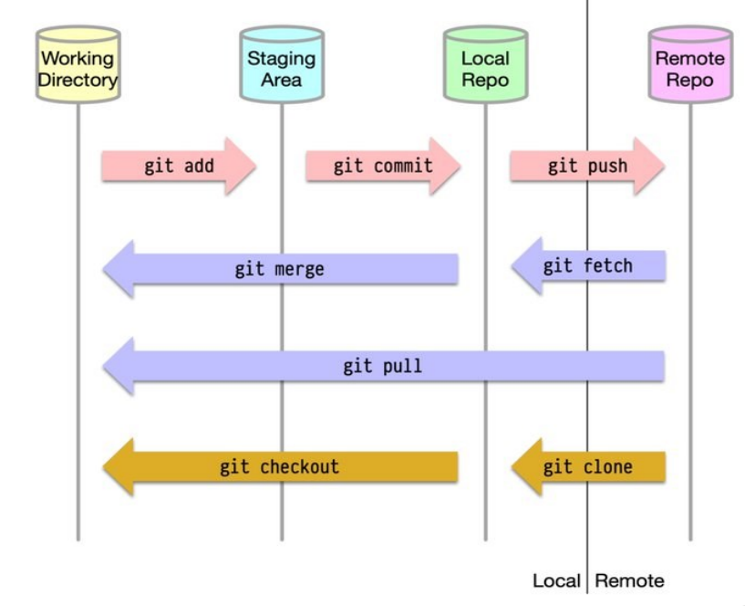
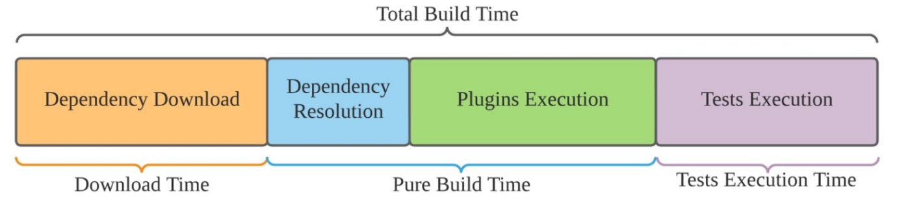
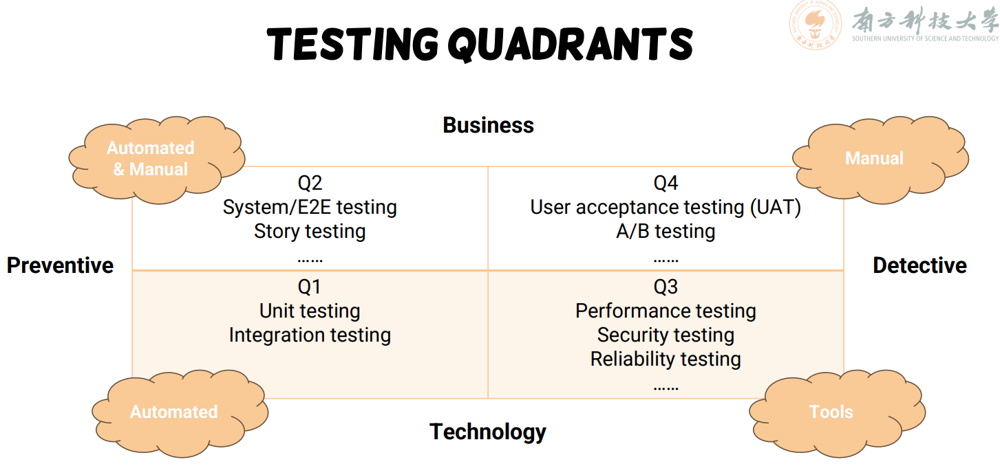
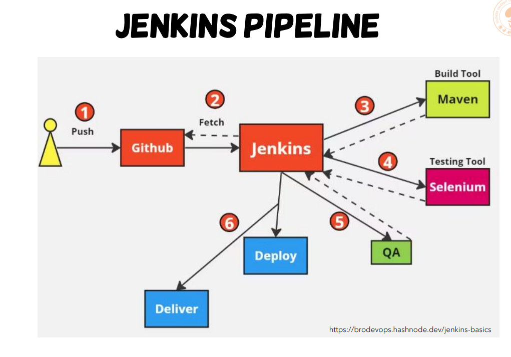
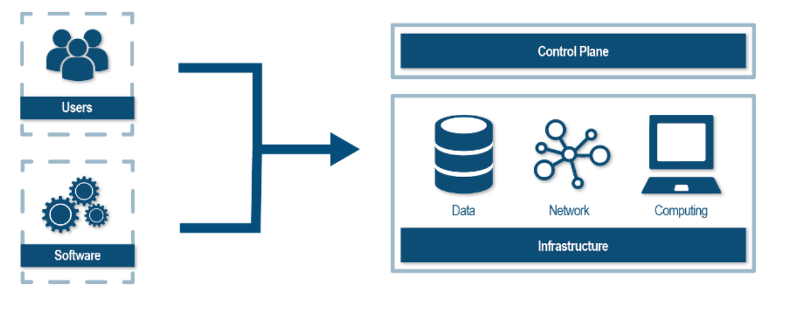
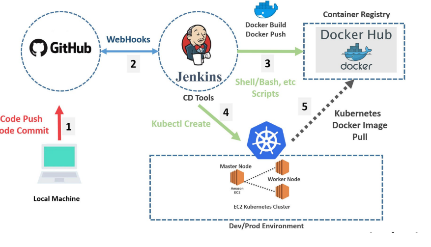
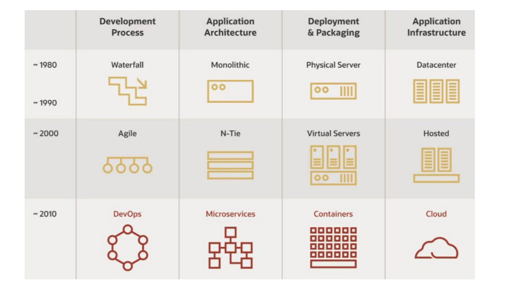
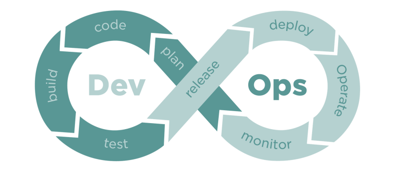

# CS304 Software Engineering Final Review

Name: Daniel

## Lecture 1 Introduction

1. Software is Long-term and Adapt-to-change
2. BUILDING A SOFTWARE VS. PROGRAMMING
   1. Programming is a significant part of software engineering
   2. Building a software is programming integrated over time, scale, and trade-offs
3. HYRUM’S LAW: Given enough time and enough users, even the most minor change WILL break something
4. Software Engineering was first formally used by Professor Friedrich L. Bauer, at NATO conference, the first conference on software engineering, in 1968
5. Software Engineering: ensuring the built is Correct, Consistent, On budget, On time, Align with the requirements
   1. Engineering: ensure structured and systematic approach
   2. Technology: provide tools and platforms for implementation
   3. Management: organizes teams and processes
6. Objective: Quality & Efficiency
7. DevOps, a software engineering practice, improves efficiency dramatically.

## Lecture 2 Process

### Software Process Overview

Software Development Life Cycle: Identify and gather requirements, plan, design, implement, test, deploy, maintain. These 7 subparts are in certain order.

### Process models

1. The waterfall model

   1. It is a sequential and linear approach for software development process
   2. 可能出现的问题就是The waterfall model might be adapted only when requirements are **well defined** and reasonably **stable**.

2. Incremental process models(增量模型)

   1. It combines elements of **linear** and **parallel** process flows
   2. PROS: reduce cost due to requirement changes, easier to get customer feedback, ...
   3. CONS:
      1. 拆分成多个增量构建之前，需要对整个模型进行良好的规划设计
      2. System structure tends to degrade as new increments are added. 所以需要花时间重构来改善，持续的变更会破坏原有的结构

3. Evolutionary process models

   Early evolutionary process models include prototyping and the spiral model.

   1. prototyping (communication, quick plan, modeling, construction of prototype, deployment and feedback)

      原型开发适用于没有detailed需求只有general objectives.

   2. spiral model (determination, risk analysis, development of deliverables, next iteration planning)

      结合waterfall model系统化的特点而设计，每轮进行风险评估，并迭代

      1. PROS: effective reducing risk, updating features
      2. CONS: complex and costly, risk analysis rely on experts

4. Agile (敏捷), in general, is the ability to create and respond to change.

   Agile is an iterative approach to project management and software development that helps teams deliver value to their customers faster and with fewer headaches

5. Agile Methodology: Scrum 

   Three Scrum roles: product owner(define and adjust product features, also choose to accept or reject work results), scrum master(coaching the scrum team), scrum team

   product backlog(PO) -> sprint planning meeting(scrum team) -> sprint backlog(scrum team) -> sprint iteration(scrum master manage, and every one should do daily scrum) -> finished work

   scrum board traditionally divided up into: To Do, Work in Progress, Done

   Ceremonies: Sprint Planning, Daily Scrum, Sprint Review, Sprint Retrospective

   Artifacts: Product Backlog, Sprint Backlog, Burndown Charts

### DevOps

1. Dev（Develop, 开发团队）: Design, develop, test, document.
2. Ops（Operation, 运维团队）: Deploy, Release, Stability of service, manage infrastructure, maintain & feedback
3. DevOps 
   1. principles: Collaboration, Automation, Monitoring&Feedback
   2. Benefits: Faster software releases, Faster feedback, Improved system reliability and stability...

## Lecture 3 Requirements

用户需求很重要, study shows that the later you identify requirement deficiencies, the higher the cost of resolving them

STAKEHOLDERS(利益相关者) is anyone who affects or is affected by the software

1. Type of requirements

   1. Business requirements: it defines the WHY behind a software project.
   2. User requirements: It describes the WHO of a software project.
   3. System requirements: It dives into the HOW of a software project.
   4. Functional Requirements: They are represented or stated in the form of input to be given to the system, the operation performed and the output expected. 
   5. Non-Functional Requirements: This requirements specify the software's quality attribute. It defines the general characteristics, behavior of the system, and features that affect the experience of the user.

2. Requirements analysis in scrum

   User study: As a (role), I want to (action), so I can (benefit/reason).

   Tasks should be small, manageable, and clear, so that everyone knows what need to be done.

   如何判断user story全部完成？

   1. In agile, acceptance criteria refer to a set of predefined requirements that must be met to mark a user story complete
2. A product owner may be responsible for writing acceptance criteria for the stories in the product backlog
   
   UML(Unified Modeling Language) 是通用的开发建模语言，提供标准化方式来建模系统的需求和设计

## Lecture 4 VCS

Version Control Systems(VCS) are software tools that help software teams track and manage modifications to artifacts (typically source code) over time.

### Version Control Systems

几种VCS:

1. Local VCSs: Local VCSs have a simple database that kept all the changes to files under revision control.
2. Centralized VCSs: have a single server that contains all the versioned files; clients check out files from that central place.
3. Distributed VCSs(git, etc...): clients don’t just check out the latest snapshot of the files. Rather, they fully mirror the repository, including its full history. Every clone is really a full backup of all the data.

### Git

1. Git Basics
   1. Snapshots, Not Differences

      不像其他系统，git是记录所有文件此时的状态，而不是记录的差异，然后如果发现没有file改变那就不会再次存储数据，而是指向之前的某一个版本

   2. Nearly Every Operation Is Local

      从本地database可以直接比较差异存储git数据

   3. Git Has Integrity

      Git stores everything in its database not by file name but by the hash value of its contents.

   4. Git Generally Only Adds Data

2. Git Architecture

   1. Local Repository
      1. **git init** to turn a normal project folder into a git working directory.
      2. **git add xxx** to stage files to be part of the next commit. 如果没有add，失去了untracked的信息的话，git无法恢复
      3. **git commit** to take files in staging area and store that snapshot permanently to your local git directory.
      4. File 有 Untracked, Staged, Committed, Modified四种状态
      5. 有working tree(directory), staging area, git directory三个section.

   2. Remote Repo
   1. To link with a remote repo, use **git remote add** on local repo or use **git clone** from a remote repo. 下图十分重要！！！
   
      
   
3. Git Internals

   1. At the core of Git is a simple key(hash)-value(sequence of bytes representing files...) data store.

   2. 3 important things

      1. Objects: content of files,  identified by SHA-1 hash, stored in .git/objects/

         Tree object: (list of pointers to blob (file)...)

         Commit object(Author info, commit message, etc.)

         Tag object(name associated with a commit (+ potential metadata))

      2. References: A branch, which is simply a pointer to an object, stored in plain text in .git/refs/
   
         (Git Branching)
   
      1. 新的commit会有一个指针指向前一个commit的hash串
         
         2. git branch & git checkout 后者才会真正转移branch，把head指向新的branch
      3. Merge commit: has more than one parent
      
      4. **git rebase**: With rebase, you can take all changes committed on one branch and replay them on a different branch. 相当于合并的更干净，原来的commit会变成新的，因为rebase re-writes the project history
         
      3. Index: a staging area, stored as a binary file in .git/index.
   
   3. Git Working Flow
   
      **git fork** 相当于复制了一个新的仓库，commit不是直接对于原始仓库commit的，不同于git clone

## Lecture 5 Architecture

### Architectural design 

1. Classic, Monolithic

   1. Data-centered architecture

      集中数据管理

   2. Data-flow architecture

      流式数据管理，每个components(filter) 独立工作控制数据流流向和过滤

      Data-flow architecture may not be suitable for GUI intensive systems

   3. Call-and-return architecture

      Main program/subprogram architecture, Remote procedure call architecture 相当于一个main调用其他的component来function

   4. Object-oriented architecture

      系统的每个部分包装数据，然后operation直接操纵object的数据

   5. Layered architecture

      层级结构

   然而这些结构 Monolithic architecture adds large overhead to the process, frustrates developers, and slows down the entire software development lifecycle.

2. Service-based, Distributed, DevOps

   1. Microkernel architecture

      Core system(只有很小的功能，使得系统操作性较强) + plug-in component(独立的组件作为extend core system功能的存在)

   2. Event-driven architecture

      Core Components: Event Producer, Event Consumer, Event channel/mediator/broker 

      这个架构具有Asynchronous and distributed 的特点

   3. Microservice architecture

      这个架构将大型应用拆分成独立的小服务，每个服务负责一个具体的业务，不同进程独立运行部署，通过API通信

      通信既有synchronous(RESTful API, gRPC(Remote Procedure Calls) 前者主要client-facing比方说前后端沟通, 后者主要是inter-service communication) 也有asynchronous(Messaging Model)
   
   Overall, when choosing which architecture to use, different architectural styles are NOT mutually exclusive; instead, they are often applied in combination

### Software UI Design

Visual Design, Interaction Design

A prototype is an early sample or model of a user interface used to test concepts and gather feedback

Prototyping: Low-Fidelity (Lo-Fi) Prototypes (低保真), Mid-Fidelity Prototypes (中保真), High-Fidelity (Hi-Fi) Prototypes (高保真)

## Lecture 6 Build

### Build System Overview

Building is the process of creating a complete, executable software by compiling and linking the software components, external libraries, configuration files, etc

### Types of Build Systems

1. Task-based Build Systems (Ant, Maven, Gradle...)

   Each task is a script of some sort that can execute any sort of logics AND Tasks can specify other tasks as dependencies that must run before them

   Create buildfiles that describe how to perform the build

   Maven: Build lifecycle, Build phase, Plugins, Goals(Smallest step of maven builds) POM包含所有necessary information about a project, as well as configurations of plugins to be used during the build process.

   A plugin provides one or more goals `mvn plugin:goal`

   然而有两个drawbacks:

   1. Difficulty maintaining & debugging build scripts
   2. Difficulty performing incremental builds & parallelism

2. Artifact-based Build Systems

   For example Bazel (Buildfiles): It describes A set of artifacts to build, Their dependencies, Limited set of configurations

   在buildfiles中定义了target(name, srcs就是为了构建这个目标所需编译的文件, deps)

   这种系统有几个好处：

   1. Parallelism Bazel 因为严格知道每个构建目标做什么、依赖什么，所以可以安全地并行构建多个目标，特别适合多核 CPU，能带来巨大的性能提升
   2. Incremental Build 当你只修改了一小部分代码时，Bazel 不会全部重新构建，而只重新构建必要的部分

3. 两种系统Comparison
   1. Task-based: 定义执行顺序，是Imperative(命令式) approach, flexible and powerful, but hard to guarantee correctness and parallelize
   2. Artifact-based: 是Declarative(声明式) approach, 只用描述输入和输出，系统自己决定如何执行build，保证了正确性以及并行性

### Build Artifact

Artifacts 需要有版本定义 semantic versioning {MAJOR(not backward compatible)}.{MINOR(backward compatible)}.{PATCH} 代表version 

Dependency Package

1. Bundle everything: pros(easy to install), cons(long time building, dedicated distributors, hard to update)
2. Leave the dependencies out: The build depends on artifacts built and stored outside of the project and typically accessed via Internet

Version Control of Artifacts

1.  Buildfile (e.g., pom.xml) should be version controlled just like source code AND Binary dependencies and artifacts are stored in other places (artifacts repository)

### Managing Dependencies (“I need that before I can have this”)

1. Internal vs External Dependency
2. Task vs Artifact Dependency 任务依赖就是必须依赖上一个任务完成；产物依赖就是编译这个的库准备好了就可以build了
3. Dependency Scopes: Compile-time, Runtime, Test
4. 依赖可能会产生一些问题(problem cases)

## Lecture 7 Quality

Quality control: **Code quality**, **Testing**

Software quality: Correctness, Readability, Maintainability, Reliability, Security, Efficiency, Portability.

### Metrics

1. LoC(Lines of Code): 难以衡量，不同的语言行数差距较大
2. Cyclomatic complexity(圈复杂度): V (G) = P(branch nodes) + 1 or V (G) = E - N + 2 并不一定是CC低的就一定更加readable.
3. OO Metrics
   1. Weighted Methods per Class (WMC): In class complexity.
   2. Depth of Inheritance Tree (DIT): Max length between node and root node.
   3. Number of Children (NOC): indicates number of immediate subclass(large NOC need lots of testing)
   4. Coupling between Object Classes (CBO): 
      1. Coupling越大class之间相关性越高 -> bad，然而CBO=0也不好，说明与system并不相关
      2. CBO doesn't care about the type or direction of a dependency
   5. Lack of Cohesion in Methods (LCOM, 类的内聚性): 
      1. Cohesion越大LCOM越低类内部方法越相关 -> good
      2. LCOM(P - Q) counts the sets of methods in a class that are not related through the sharing of some of the class's fields. 其中Q代表一对方法都访问了类中的同一个字段；P代表一对方法没有访问任何相同的字段

### Linters

1. A linter (静态语法检查器) is a tool that analyzes source code for style, syntax, and potential errors that can lead to bugs and vulnerabilities. 
2. Linters对于类似JS, Python这样语言更加useful因为他们没有严格的rule
3. Linters are static (work on source or byte code), without having to execute code.

### Code Review

Types of Code changes to be reviewed
1. Modifications to existing code
2. Entirely new code
3. Automatically generated code

## Lecture 8 Testing

In Developer Driven Testing (DDT), developers write their tests by themselves, only when they feel they’re done with the code. 开发者自行进行提供测试样例并且自动化进行测试，而不是tester进行测试

### Concepts

1. Test case vs Test suites，后者一般是前者的集合，test suites are the logical grouping or collection of test cases to run a single job with different test scenarios.
2. test input指的是程序的输入，test oracle指的是判断是否正确的依据(**测试预言**是一个没有错误的“正确输出来源”，可以对每一个测试输入给出一个应该返回的正确结果。)这个准则可以来自formal specification, human judgement...

1. Unit Testing：单元测试，对组件分开测试

2. Integration Testing：组件测试之后，这个测试verify the interaction and behavior of multiple components.

3. System Testing: 整个系统测试，确保符合business specifications

4. Test Size: Small(in a single thread), Medium(in a machine), Large(multiple machines over network)

5. Performance Testing

6. User Acceptance Testing(UAT): The last phase of software testing before making the system available for actual use.

7. A/B Testing is a user experience research methodology. It compares multiple versions of a single variable (e.g., the color of a button), and determines which of the variants is more effective.

### Testing Techniques

Black-box testing（黑盒测试）: based on software specification不看代码; 不看内部怎么实现; 只看输入输出确保涵盖所有行为(Test every possible input based on specification)

1. Pros: 简洁，realistic results
2. Cons: coverage有限，incomplete testing
3. Exhaustive Testing: 测试所有可能输入但是not feasible time
4. Test data selection
   1. Random Testing
   2. Partition Testing：将输入划分成等价类，然后test inputs就是从每个等价类中选择
   3. Equivalence Partition Hypothesis: If one condition/value in a partition passes all others will also pass. Likewise, if one condition in a partition fails, all other conditions in that partition will fail.
   4. Boundary Values: Errors tend to occur at boundary of a (sub)domain

White-box testing（白盒测试）: based on code看代码; 看代码逻辑; 确保所有语句被测试到(Test every possible code path)

1. Pros: comprehensive testing, early defect detection
2. Cons: expensive, requires technical expertise
3. Statement Coverage 表示白盒测试每个statement测试（一般是行数）的覆盖率，并不是所有testcase SC加起来是100%就一定测试完整了
4. Branch Coverage 表示所有的branch测试的覆盖率 
5. Condition Coverage 测试一般需要branch和condition覆盖率都到100%

## Lecture 9 Testing2

### Maintainable Unit Tests

1. 最终目标(Ultimate Goal)是 Ideally, after a test is written, it never needs to change unless the requirements of the system under test change. Only changing the system’s existing behavior would require the updates to existing tests
2. Refactoring不应该改变system behavior, New features可能需要新的test, Bug fixes可能也需要新的test.
3. Good Practice
   1. Use Public APIs(就像user一样，不要test写只有developer访问的private方法)
   2. Test Behaviors, Not Methods: Writing a behavior-driven test rather than writing a test for each method, write a test for each behavior

### Test Doubles

可能由于network或者复杂系统以及其他不稳定原因，test doubles在一些案例是必要的

1. **Test Doubles**（测试替身）是测试时用来“伪装成某个真实组件”的对象
2. 几种test doubles类型
   1. Stub: A stub doesn’t contain real logic; it’s only there to respond to specific inputs with specific outputs.
   2. Fake: A fake implements real logic but in a simplified or in-memory way.
   3. Mock: A mock is similar to a stub, but with behavior verification added in. Make assertions about how your SUT interacted with the dependency 相当于断言成功执行了某个函数，具体后面的东西可能是某个复杂系统的行为不用管

### UI Testing

We are looking for **Consistency, Spelling, Typography(排版), Behavior of interactive elements, Functional validation, Adaptability** in UI Testing.

### Evaluating Test Cases

1. Test Metrics: Effectiveness, Efforts

   Coverage, Test tracking, Defect tracking

2. Mutation Testing: Mutation testing (变异测试) begins with a unit and a set of test cases for that unit, such that all the test cases pass when executed. 用来证明test sharp enough to catch small bugs.

   1. A small change is made to the original unit, based on a list of predefined mutation operators (突变算子).
   2. Tests are executed on the mutants. If all test cases succeed, the mutant lives. If at least one test case fails, the mutant is killed. 
   3. Compute the mutation score(Higher mutation score increases the confidence of using the original test cases) 相当于是如果测试样例足够强，应该很容易发现代码的小错误

3. Fuzzing: 自动地向系统（SUT，System Under Test）输入一些无效的、意外的或随机的数据，看看程序会不会出错

   1. A fuzzer can be generation-based: inputs are generated from scratch AND mutation-based: inputs are created by modifying existing inputs.
   2. A fuzzer can be white-box or black-box, depending on whether it is aware of program structure.

## Lecture 10 Documentation

1. External Software Documentation
   1. End-user documentation: user-guide...
   2. Just-in-time documentation: FAQ pages...
2. Internal Software Documentation
   1. Administrative documentation: the high-level administrative guidelines, product requirements...
   2. Developer documentation: provides instructions for developers for building, extending...

### Good Documentation

1. Self-documenting(or self-describing) code enable use and understanding

2. Code Comments: Should answer WHY, instead of WHAT(not simply repeating the code)

3. The best documentation is the code itself.

4. Javadoc 一般包括 The description of what we're commenting on, The standalone block tags (marked with the “@” symbol) which describe specific meta-data.'

   Javadoc comments may be placed above any class, method, or field which we want to document.

5. Less Recognized Documentation: Tests, git commits...

6. Documentation is treated as code

## Lecture 11 CI/CD

### Continuous Integration (CI)

The fundamental goal of CI is to automatically catch problematic changes as early as possible.

Compared to build locally, CI servers can make sure: Consistency, Automation, Scalability, Immediate Feedback

Jenkins is an open-source CI server. It helps automate building, testing, and deploying process

### Continuous Delivery and Deployment

1. Environments: Development Environment, Staging Environment(use to validate, perform integration testing and simulation), Production Environment

2. Continuous delivery 自动化的deploy所有的code change to a staging and production environment.

   Continuous deployment 会多做一步，多一个deploy to production步骤 (所以所有步骤都将是自动的除非有fail test)

3. CI/CD pipeline

   Common components of a deployment pipeline: Version control, Artifact repositories, Build automation tools, Automated testing tools, Continuous integration (CI) servers, Deployment tools 

   

   Pipeline breakdown: （☆）

   1. Stage 1: 构建与初步验证，将生成的二进制文件存储到 Artifact仓库

   2. Stage 2: 自动化测试阶段（stage 1完成自动触发），验证系统功能

      **Smoke Test（冒烟测试）**：快速验证构建版本主要功能是否正常，是 QA 是否继续深入测试的依据

   3. Stage 3: 部署和发布，将通过验证的版本部署到生产环境（deploys the verified binary version to the production environment with one button click）

   4. CI/CD VS. RAPID RELEASE
   
      1. Deployment: making the software available for use, in staging or production environment
      2. Release: making the software accessible by end users in the production environment.
      3. CI/CD is sometimes also referred to as “rapid release” (高频发布)

### Deployment Strategy

1. Expectations: 

   1. Zero Downtime
   2. Quick to market and rapid release
   3. Quick customer feedback on new release
   4. Easy to roll back

2. Deployment Strategies

   1. Blue-Green Deployment

      Blue 环境环境运行老的版本，新的版本使用green进行开发，当确定新的正常工作了，就可以destroy老版本了 

      1. 好处就是很好rollback 以及minimal downtime
      2. 缺点就是expensive 以及data consistency and integrity problems

   2. Rolling Deployment

      server cluster有多个服务器 performing functions 每次更新部分服务器，其他仍运行旧版本的服务器继续处理用户请求，常配合负载均衡器使用 

      1. 优点是成本比较低，minimal disruption for users, 不需要double资源
      2. 缺点是用户体验不一致，难以rollback, 故障扩散风险以及新版本上线延迟高

   3. Canary/Greyscale Release

      **先将新版本发布给一小部分用户**，监控其效果，再决定是否全面发布或回滚

      1. 优点是真实用户体验，降低风险，灵活rollback
      2. 缺点是Complex traffic routing（为了只让**部分用户**访问新版本时候系统需要对用户的请求进行**精细控制和分流**，这会让流量管理变得复杂），监控需求高，小群体用户可能不够代表性

   4. Supporting technology: Feature toggle

      在代码中增加条件判断，用来**控制某个功能是否开启**，不需要重新部署

      You can manage toggles from a central service or configuration file, often without requiring new deployments or code changes.

### Branching Strategy

1. Trunk-based dev & release (主干开发，主干发布)

   直接在主干上merge然后发布

   1. 好处是less management, fast feedback
   2. 坏处是没有完全开发的工作影响发布，难以rapid release, 将分支合并回主分支会变得困难

2. Trunk-based dev & branch-based release (主干开发，分支发布)

   准备发送版本时候，从主干中某个稳定的提交创建一个release分支，在release上作非常有限的修改

   如果发布版本有 bug，**先在 trunk 上修复**，然后 **cherry-pick（挑拣）** 到 release 分支 **不要只在 release 分支上修复**，否则 trunk 没修，未来可能又引入相同 bug（回归 bug）

   1. 优点是开发很少受release影响，release不会被没完成的工作影响
   2. 劣势是如果存在多个版本维护（多个 release 分支）就会导致Release Branch Hell 多个 release 分支并存，维护成本高 bug 修复要手动同步多个分支（trunk + 所有活跃 release 分支）

3. Branch-based dev & trunk-based release (分支开发，主干发布)

   开发者每开始新的feature工作时候就创建一个新的分支，feature分支当被完成并且测试完成之后就合并到主分支

   1. 好处是独立开发，可选择哪些feature发布，如果bug出现可以直接在main上修改，而不会影响feature
   2. 坏处是big merge的风险，以及延迟integration

4. GitFlow Branching Strategy

   1. Master 最终发布的分支
   2. Develop 从上一个版本master拉出来，合并feature的主分支
   3. Feature 从develop拉出来写feature然后合并回去
   4. Release: 用作develop阶段的pre发布，当完成了beta release修复了bug之后merge回master
   5. Hotfix: 如果master发布的0.1版本有bug 进行quick fixing 最后发布0.2版本，记得这些bug修改的东西也应该merge回develop分支

5. Facebook分阶段发布流程 C1, C2, C3

   1. C1内部员工，经过一系列CI之后推送到内部员工，这阶段有非常多的内部监控机制
   2. C2线上用户，推送给2%的真实用户观察使用
   3. C3全面上线，如果一切正常，逐步推送到所有用户，一旦发现异常可以立即停止发布然后roll back

## Lecture 12 Cloud-native

### Deploy & Infrastructure

1. Deploy to 50+ servers

   Challenges:

   1. 没有容错机制，不能自动把一个down的任务自动迁移到别的机器上

      Solution: Automate the deployment through a shell script，达到一个可以复用易于维护的效果

   2. 监控是临时拼凑的 监控任务的方式是**人工或者用临时脚本手动查看**，效率低，容易出错（ad hoc manner）

      Solution: Automate the monitoring of server status

      Solution: Automate the anomaly handling, (e.g., kill and reboot the process)

   3. 由于processes相互之间干扰，可能会有资源抢夺，所以这是一个复杂的，需要人为介入调度资源分配的过程

      Solution: Isolation, 达到每个process独立安全的运行

      Solution: Auto-scheduling，一个central service直到完整的machine list，然后挑出没有使用的机器来自动化deploy

      Solution: Auto-scaling, automate the settings of configuration parameters.

   Scaling: Vertically(给existing server添加更多的资源), Horizontally(添加更多的server,分布式处理)

2. Infrastructure

   

   

   1. Computing

      1. Hardware: servers, computers, ...
      2. Software: OS, applications, firewalls, ...

   2. Network(routers...)

   3. Data Centers(construction, management...)

   4. Monitoring and control plane: captures log files from throughout a network and aggregates them into a single database

      三种monitoring: hardware, network, application monitoring.

      Infrastructure monitoring creates opportunities to proactively identify security risks and mitigate operational issues

   5. Scale out - Complexity

      1. Load Balancing（负载均衡）必须合理分流到各个服务器
      2. Configuration（配置）每增加一台服务器，都要进行网络、安全等配置，以确保它能和现有系统正常配合。
      3. Monitoring / Troubleshooting（监控与故障排查）服务器越多，监控就越困难。出问题时也更难快速定位是哪台机器、哪个服务出错了。
      4. Maintenance（维护）更多的服务器 = 更多的硬件/软件需要维护、更新、打补丁

   6. 传统的本地部署（On-premise infrastructure）

      组织需要部署自己的数据中心，部署服务

      Drawback: Significant manual intervention, Long release cycle, Complex, time consuming, error-prone

### Cloud-native Applications

For an application to be considered as cloud-native, it should at least adopt these 4 approaches or technologies: Processes(DevOps & CI/CD), Architecture(Microservices), Deployment(Containers), Practice(Infrastructure as code)

1. Architecture

   1. Mono版本扩展性不强，packaged in a single executable，难以scale浪费deployment resources

   2. microservices包括很多小的相互依赖的services，这种架构由很多小组件完成

2. Deployment

   1. Language-specific package pattern 每个服务用某种特定语言（如 Java）开发，**编译成该语言特有的可执行文件**（比如 `.jar`），然后部署到一台 **已安装对应运行环境**（如 JDK 或 JRE）的机器上运行

      Drawback: Lack of encapsulation of the tech stack, Lack of isolation, Hard to constrain the resource consumed by a service instance, Manually determine the resources assigned to service instances

   2. Virtual machine 构建时候创建AMI，每个服务实例就是一个虚拟机

      Drawback: 资源利用率低，部署慢(构建VM花费时间，image比较大，难以移动到整个network)

   3. Container 容器是一种轻量级的、可移植的**软件打包方式**，它将应用程序及其所有依赖（如库、配置、运行时等）**打包成一个独立单元**，可以在任何支持容器运行的环境中运行。

      1. 容器内部的程序**感觉自己是在独立主机上运行**。它拥有自己的 root filesystem（根文件系统）、PID空间、网络接口等。

      2. Developers can easily create, deploy, and run applications in a consistent and predictable manner across different servers or cloud platforms.

      3. Container communication: 每个容器在他运行的网络环境中，会被分配一个唯一的IP地址，然后容器之间就可以像普通计算机一样进行通过标准网络协议沟通

      4. Container的部署

         Build-time(构建阶段)会将整个服务被打包成一个容器镜像Container Image，然后Runtime(运行阶段)会拉取所有镜像然后启动运行在虚拟机上，single VM通常会有多个containers

      5. Docker

         Dockerfile ->(build) Docker Image ->(run) Docker Container(a running instance of a docker image)

         1. Dockerfile build -> push -> pull -> run (在本地)
         2. Docker image Docker 镜像并不是一个单一的大文件，而是由多个 **层（layers）** 组成的分层结构。每一层都是只读的，镜像最终通过这些层叠加而成。
            1. Kernel （内核）Docker使用宿主机的内核
            2. Base Image（基础镜像）来自dockerfile
            3. Intermediate Layer（中间层）是由dockerfile中的构建指令(run, add, workdir)生成，每一条指令会创建一个只读层
            4. Container Layer（容器层）也是由dockerfile中运行时的指令(cmd, entrypoint)构建生成，这些不会在构建镜像时候被执行，而是在运行容器时候生效，当docker启动容器时候会添加一个writable层，记录着runtime时候所有的变化 那么也就意味着多个容器可以基于一个image启动，但是彼此的更改时相互隔离的，拥有各自的writable layer

      6. Container的drawback: 需要管理container images以及infrastructures

         为了可靠地部署服务，你必须使用一个 Docker 编排框架（orchestration framework，比如Kubernetes）使用这个服务你可以自动化的管理task比如deploying containers across servers, scaling or removing containers...

         Kubernetes Architecture (A control plane and one or more compute machines, or worker nodes)

         1. Control plane(master) 负责整个集群的决策和协调以及scheduling
         2. worker node是实际运行应用程序容器的地方
            1. Pod: 最小部署单元，host一个或多个containers
            2. Kubelet: 每个工作节点上运行的守护进程负责管理本机的pod以及容器以及和master通信
            3. Container runtime: 运行container时候在worker node采取一系列比如pull, run, manage之类的操作
            4. Kube-proxy: 节点上的网络代理
         3. YAML File 这个文件定义了创建了什么资源，多少副本，使用什么容器镜像... 相当于是描述了集群中各种资源的期望状态(desired state)

         K8S deployment strategy

         1. Rolling: 逐个或批量替换掉旧的pod 好处就是minimize downtime, safe
         2. Recreate: terminate all the running instances then recreate them with the newer version. 好处就是fast, consistent

3. Infrastructure as code(Practice)

   用代码（而非手动操作）来定义和管理服务器、网络、存储等基础设施。

   IaC的特点: 像写软件一样写基础设施，代码可以存放在 Git 等版本控制系统中，结合自动化工具执行部署

   

   自动化步骤如下

   1. 配置 GitHub Webhook
   2. 开发者将本地代码提交（push）到 GitHub
   3. Webhook 触发 Jenkins 自动拉取最新代码。
   4. Jenkins 自动执行任务，常见任务包括：使用 Maven 构建项目，使用 JUnit 运行测试，构建 Docker 镜像，将 Docker 镜像上传到 Docker Hub
   5. Jenkins 可配置为将构建好的镜像部署到 Kubernetes 集群。
   6. Kubernetes 从 Docker Registry 拉取镜像并启动服务

## Lecture 13 Evolution

### Software Maintenance（软件维护）

主要分为三个方面: fault repair, environmental adaptation, functionality addition or modification

1. Maintainability

   更多的bug以及failure会带来维护性的降低，更长的impact analysis会导致降低，长时间implement一个change会导致维护性降低

2. Technical debt

   技术债是指在软件开发中为了**短期速度**做出的**不理想或临时性技术决策**，这些决策未来会导致额外的工作量去修复、重构或重做。

   技术债的危害：增加维护成本，降低开发效率，增加出错风险，拖慢未来的新功能开发(bottleneck, liability...)

3. Refactoring

   Preserves the external behavior of the software, Improves the internal structure of the software

   Refactoring is a disciplined way to clean up code so that it is easier to read and cheaper to maintain 

   什么时候进行refactoring: 第三次开始做同样的事情refactor, when adding a feature, when fixing a bug, during a code review

   refactor什么: when code doesn't smell good

   Types of code smell:

   1. Bloaters 代码臃肿，比如long method, long parameter list

   2. OO Abusers (Object-orientation abusers) Object-orientation abusers are a type of code smells that refers to incorrect or incomplete implementation of Object Oriented Concepts 意思是开发者没有正确或完整地实现面向对象编程（OOP）的核心概念，比如继承、多态、封装等。虽然语法上可能没有错，但设计上违反了OOP的原则。举例子来讲就是如果子类继承了父类但并不需要全部父类的行为

      Liskov Substitution Principle(LSP) 规则通俗来说就是子类的对象应该能够替换父类的对象，并且程序的行为仍然正确。所以OO Abusers就违反了LSP规则

   3. Change Preventers 意思是 if you need to change something in one place in your code, you have to make many changes in other places too 这违反了 Single Responsibility Principle

   4. Couplers 耦合度过高意味着模块之间太过依赖，违反了**模块独立性和封装性**的设计原则

   5. Dispensables: A dispensable is something pointless and unneeded whose absence would make the code cleaner, more efficient and easier to understand.

4. Re-architecting

   Mono -> Microservices: Incrementally and gradually refactoring the monolithic application.

   Rearchitecting Strategies:

   1. Implement new features as services
   2. Separate the presentation tier and backend
   3. Break up the monolithic by extracting functionality into services

### Software evolution（软件演化）

Why costly: need to migrate to new platforms, complexity grows, costly to get new comers familiar with the software

1. Legacy systems (遗留系统) are outdated software or hardware that is still in use despite being replaced by newer technology

   为什么不直接替换掉Legacy code呢？因为too expensive(过于久远很难understand, lack of test and specifications), too risky(一些important business rules可能会embedded implicitly)

   Decisions for Legacy System:

   1. (彻底弃用) Abandon the system completely 

   2. (常规维护) Leave the system unchanged and continue with regular maintenance

   3. (现代化) Modernize the system to improve its maintainability.

      Modernization the process of updating legacy software systems to improve efficiency, maintainability, and integration with modern technologies.

   如何评估应该怎么办: system quality + business value

2. Deprecation: the formal process of orderly migration away from and eventual removal of obsolete (过时) systems

   什么东西应该被deprecated呢？

   1. **已经过时（obsolete）**：这个东西老旧、落后、不再适合当前需求。
   2. **已经有更好的替代方案（replacement exists）**：并且这个替代方案能提供**相似甚至更好的功能**。

   怎么样deprecate elegantly:

   1. Dependency Discovery(dependency过多意味着难以deprecate)
   2. Warning flags
   3. Sunset period(让用户由充分的时间进行过渡)
   4. Migration & Testing

   deprecate一个系统需要决定：who is using, how its being used

   
   
   

## Labs

1. UML(Uniformed Modeling Language) 有很多种diagram，大致分为两类：
   1. Structure Diagram：结构图标识系统的静态方面，强调了必须存在于正在建模系统中的事务
   2. Behavior Diagram：行为图描述的是对象的动态行为
2. Maven is a software project management and comprehension tool, can be used for building and managing any Java-based project. Based on the concept of a project object model (POM), Maven can manage a project's build, reporting and documentation from a central piece of information.
3. Testing: Junit, JaCoCo
4. CI/CD tool: Jenkin
5. Docker is an open-source engine that automates the deployment of applications into containers.
6. Kubernetes (K8s) enables us to manage a cluster of containers.

## Tips Overall

1. Software Engineering(Engineering, Technology, Management): ensuring the built is Correct, Consistent, On budget, On time, Align with the requirements

2. Software Engineering Objective: Quality & Efficiency

3. Software Development Life Cycle: Identify and gather requirements, plan, design, implement, test, deploy, maintain.

4. Process Model: 

   1. Waterfall model
   2. Incremental model（基于feature的增量所以应对change比较好，但需要较好的规划）
   3. Evolutionary model: prototyping, spiral model(iterative + waterfall)

5. Agile is an iterative approach: Scrum

   Three roles: Product owner, Scrum master, Scrum team

   Ceremonies: Sprint Planning, Daily Scrum, Sprint Review, Sprint Retrospective

   Artifacts: Product Backlog, Sprint Backlog, Burndown Charts

6. Requirement(Functional, Non-Functional) types: Business, User, System

   In scrum it is a User study: As a (role), I want to (action), so I can (benefit/reason).

7. Local, Centralized, Distributed VCS(git)

8. Git File 有 Untracked, Staged, Committed, Modified四种状态

9. Git Internals: Objects(tree, commit, tag), References(branch, pointing to objects), Index

10. Service-based, Distributed, DevOps Architecture: Microkernel, Event-driven, Microservice

11. Build system: Task-based(Imperative, Maven(Build lifecycle, Build phase, Plugins, Goals)...), Artifact-based(Declarative, Bazel...)

12. Artifacts 需要有版本定义 {MAJOR(not backward compatible)}.{MINOR(backward compatible)}.{PATCH} 代表version

13. Buildfile (e.g., pom.xml) should be version controlled just like source code AND Binary dependencies and artifacts are stored in other places (artifacts repository)

14. Metrics: LoC, CC, Object-Oriented(WMC, DIT, NOC, CBO, LCOM)

    Coupling越大class之间相关性越高 -> bad，然而CBO=0也不好，说明与system并不相关

    Cohesion越大LCOM越低类内部方法越相关 -> good

    LCOM(P - Q) counts the sets of methods in a class that are not related through the sharing of some of the class's fields. 其中Q代表一对方法都访问了类中的同一个字段；P代表一 对方法没有访问任何相同的字段

15. Testing: Unit, Integration, System

    A/B Testing is a user experience research methodology. It compares multiple versions of a single variable (e.g., the color of a button), and determines which of the variants is more effective.

16. Testing Technique: Black-box

    Test data selection: Random, Partition

    Boundary Values: Errors tend to occur at boundary of a (sub)domain

17. Testing Technique: White-box(Statement Coverage, Branch Coverage, Condition Coverage)

18. Testing 最终目标(Ultimate Goal) 是 Ideally, after a test is written, it never needs to change unless the requirements of the system under test change. Only changing the system’s existing behavior would require the updates to existing tests

    Refactoring不应该改变system behavior, New features可能需要新的test, Bug fixes可能也需要新的 test.

19. Test Doubles(Stub, Fake, Mock)

20. UI testing: Consistency, Spelling, Typography(排版), Behavior of interactive elements, Functional validation, Adaptability

21. Test case Evaluating(Metrics are effectiveness and Efforts)

    Mutation Testing 给代码做一点小改变，如果mutant been killed就说明测试样例足够强

    Fuzzing(generation-based, mutation-based)

22. External Software Documentation(End-user, JIT), Internal Software Documentation(Administrative, Developer)

23. The fundamental goal of CI is to automatically catch problematic changes as early as possible.

    Compared to build locally, CI servers can make sure: Consistency, Automation, Scalability, Immediate Feedback

24. CD Environments: Development Environment, Staging Environment(use to validate, perform integration testing and simulation), Production Environment

25. Common components of a deployment pipeline: Version control, Artifact repositories, Build automation tools, Automated testing tools, Continuous integration (CI) servers, Deployment tools

26. Deployment expectation: zero downtime, easy rolling back, quick to market and rapid release, quick customer feedback

    Strategies: Blue-green, rolling, Canary

27. Branching Strategies: Trunk-based dev & release, Trunk-based dev & branch-based release,  Branch-based dev & trunk-based release, GitFlow(Master, Develop, Feature, Release实际上是pre发布, Hotfix)

    Facebook: C1, C2, C3

28. Scaling: Vertically(给existing server添加更多的资源), Horizontally(添加更多的server,分布式处理)

29. 三种monitoring: hardware, network, application monitoring

30. Scale out - Complexity: Load Balancing, Configuration, Monitoring/Troubleshooting, Maintenance

31. For an application to be considered as cloud-native, it should at least adopt these 4 approaches or technologies: Processes(DevOps & CI/CD), Architecture(Microservices), Deployment(Containers), Practice(Infrastructure as code)

32. Deployment: Language-specific package pattern, Virtual Machine, Container

    Dockerfile ->(build) Docker Image ->(run) Docker Container(a running instance of a docker image)

    Docker image 有很多layer: Kernel, Base Image基础镜像, Intermediate Layer(dockerfile创建的只读层), Container Layer(在运行时候生效，启动时候会生成writable层记录运行时候的变化)

    K8S(control plane, worker node(pod, kubelet...)) 是一种管理container的编排工具，自动化管理task

    K8S deployment: Rolling, Recreate

33. Re-factoring Strategy: Implement new features as services, Separate the presentation tier and backend, Break up the monolithic by extracting functionality into services

34. 使用system quality + business value来评估针对Legacy system的解决方案

35. deprecate情况：obsolete, replacement exists. How to Deprecate elegantly: Dependency Discovery, Warning Flags, Sunset period, Migration & Testing

36. 

    

